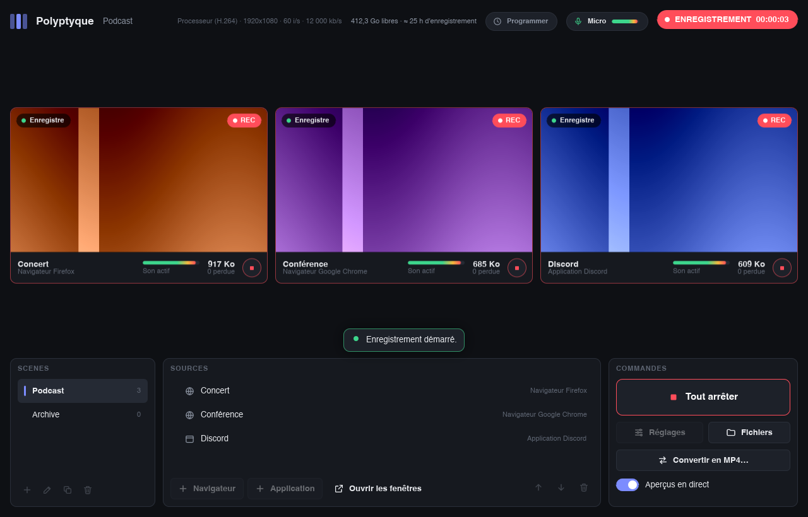

<p align="center">
  
</p>

<h1 align="center">Polyptyque</h1>

<p align="center">
  <strong>Enregistrez plusieurs fenêtres en même temps, chacune dans son propre fichier, avec son propre son.</strong><br>
  Pour le montage multi-angle et l'archivage, sur des sessions qui peuvent durer douze heures.
</p>

<p align="center">
  <a href="README.md">English</a> · <strong>Français</strong>
</p>

<p align="center">
  
</p>

<!--
  Liens épinglés sur la bêta : releases/latest/download/ ignore les préversions
  et renvoie 404 tant qu'aucune version stable n'est publiée. À chaque nouvelle
  bêta, mettre à jour l'étiquette et la ligne de version (ici et dans
  README.md). À la sortie de la
  1.0.0 stable, passer aux adresses permanentes :
  https://github.com/venaciteam/polyptyque/releases/latest/download/Polyptyque-Setup.exe
  https://github.com/venaciteam/polyptyque/releases/latest/download/Polyptyque-portable.zip
-->

## Télécharger

**Windows 10 et 11** (64 bits), version 1.0 bêta 8 :

- **[Télécharger l'installateur](https://github.com/venaciteam/polyptyque/releases/download/v1.0.0-beta.8/Polyptyque-Setup.exe)** : la version classique, qui s'installe comme un logiciel habituel. Dans le doute, choisir celle-ci.
- **[Télécharger la version portable](https://github.com/venaciteam/polyptyque/releases/download/v1.0.0-beta.8/Polyptyque-portable.zip)** : sans installation, à décompresser dans le dossier de son choix, même sur une clé USB.

macOS et Linux : pas encore disponibles.

Configuration requise et message de Windows au premier lancement : voir [Installation](#installation).

---

## Sommaire

- [Pourquoi Polyptyque](#pourquoi-polyptyque)
- [Ses atouts](#ses-atouts)
- [Léger par conception](#léger-par-conception)
- [Installation](#installation)
- [Prise en main](#prise-en-main)
- [Piloter Polyptyque avec un assistant IA](#piloter-polyptyque-avec-un-assistant-ia)
- [Pour le montage](#pour-le-montage)
- [Limites connues](#limites-connues)
- [Signaler un problème](#signaler-un-problème)
- [Pour les développeurs](#pour-les-développeurs)
- [Licence](#licence)

## Pourquoi Polyptyque

Les logiciels d'enregistrement classiques composent une seule image à partir de plusieurs sources, et l'enregistrent dans **un seul fichier** avec **un seul mélange sonore**. Pour monter ensuite chaque source séparément, il faut des extensions fragiles, et le son reste mélangé : deux fenêtres de navigateur jouent dans le même programme, donc dans la même piste.

Polyptyque fait l'inverse : **chaque fenêtre est enregistrée à part**, dans son propre fichier, avec **uniquement son propre son**. Trois fenêtres donnent trois fichiers, calés sur la même horloge, prêts à être superposés dans un logiciel de montage.

## Ses atouts

**Le son de chaque fenêtre, et rien d'autre**
- Chaque source navigateur a son propre profil : le son d'un onglet de Firefox ne se mélange pas avec celui d'un autre Firefox, ni avec Chrome ou Discord.
- Le son d'une application (Discord, un jeu, Tor Browser…) est capté à la source, sans le reste du système.
- Micro en option, dans un fichier séparé, et testable dans les réglages avant d'enregistrer.

**Des fichiers prêts pour le montage**
- Un fichier par source, toutes sur une horloge commune : l'image et le son restent alignés d'un fichier à l'autre.
- Cadence d'images constante, attendue par les logiciels de montage, même quand une fenêtre ne bouge pas.
- Conversion en MP4 sans perte de qualité, pour Premiere Pro et les autres logiciels qui gèrent mal le MKV.

**Pensé pour les longues sessions**
- Testé sur 14 h 15 d'enregistrement continu avec trois sources : aucune coupure, fichiers calés à quelques millisecondes près, mémoire stable.
- Fichiers écrits au fil de l'eau : un plantage ne fait perdre qu'environ une seconde, et un fichier coupé net (panne de courant) reste lisible.
- Espace disque surveillé, avec arrêt propre s'il vient à manquer.
- Mise en veille automatique empêchée. Une mise en veille demandée (capot fermé, bouton) ne peut pas l'être : l'enregistrement est alors arrêté proprement, et sa reprise proposée au réveil.
- Si Windows s'éteint ou se déconnecte pendant un enregistrement, il le signale et laisse annuler ; sinon, les fichiers sont finalisés avant la fermeture.

**Enregistrements programmés**
- Début et fin à heure fixe, une seule fois ou certains jours de la semaine : chaque programmation lance une scène, y compris la nuit (créneaux qui passent minuit) et aux changements d'heure.
- Tant qu'une programmation est active, l'ordinateur et l'écran ne se mettent pas en veille d'eux-mêmes. Fermer la fenêtre propose de continuer en arrière-plan, avec l'icône de Polyptyque près de l'horloge, et Polyptyque peut se lancer au démarrage de Windows directement en arrière-plan, pour que les programmations survivent à un redémarrage.
- Démarrage manqué (Polyptyque fermé ou ordinateur en veille à l'heure prévue) : à son retour pendant le créneau, Polyptyque demande s'il faut lancer l'enregistrement, et le lance seul au bout de deux minutes sans réponse.
- La programmation n'arrête que ce qu'elle a lancé : un enregistrement lancé à la main pendant un créneau n'est arrêté à l'heure de fin que si on l'accepte. Arrêter à la main un enregistrement programmé demande confirmation.

**Résistant aux incidents**
- Après un plantage ou une coupure de courant, Polyptyque fait le bilan des fichiers au lancement suivant, propose de réparer ceux qui ont été coupés net (sans perte de qualité) et de reprendre l'enregistrement.
- Si l'encodeur s'arrête ou se fige, Polyptyque le relance seul, dans un nouveau fichier, sans interrompre les autres sources.
- Une fenêtre fermée ou plantée donne une image noire, puis est rattachée automatiquement dès qu'elle revient. Un navigateur fermé par erreur est rouvert tout seul ; une fenêtre réduite revient d'un clic, même si son écran a été débranché.
- Disque externe débranché en cours de route : la suite est enregistrée dans `Vidéos\Polyptyque`.
- Réglages protégés : version précédente et sauvegarde quotidienne, restaurées automatiquement si le fichier est abîmé.

**Il retrouve vos fenêtres**
- Les navigateurs sont reconnus par leur profil, pas par leur titre qui change à chaque onglet.
- Au lancement, Polyptyque ouvre les fenêtres de la scène en cours (désactivable dans les réglages). Le bouton « Ouvrir les fenêtres » les ouvre à la demande, celui de chaque carte une seule.
- En quittant Polyptyque, les navigateurs des sources se ferment avec lui et retrouvent leurs onglets au lancement suivant (désactivable dans les réglages). Les applications restent ouvertes.
- Au démarrage d'un enregistrement, Polyptyque rouvre les fenêtres absentes : chaque navigateur revient sur ses onglets, connexions conservées.

**Simple à utiliser**
- Scènes (groupes de sources), aperçus en direct de chaque source, raccourcis clavier globaux.
- Une même source dans plusieurs scènes : copier, coller (clic droit, ou <kbd>Ctrl</kbd> + <kbd>C</kbd> / <kbd>Ctrl</kbd> + <kbd>V</kbd>), ou dupliquer toute une scène. C'est la même fenêtre et, pour un navigateur, les mêmes connexions : rien à reconfigurer.
- Sources réordonnées par glisser-déposer, dans la liste ou directement dans la grille des aperçus (ou avec les flèches).
- Niveau sonore de chaque source affiché en permanence, même sans enregistrer : une source muette se repère avant de lancer l'enregistrement.
- Un bouton pour tout enregistrer, ou un bouton par source pour enregistrer une source seule.
- Encodage par la carte graphique (NVIDIA, AMD, Intel) quand elle est disponible, ou par le processeur. Si la carte refuse un encodage de plus (limite des cartes GeForce, autres logiciels compris), la source passe seule sur le processeur.
- Pilotable par un assistant IA, un script ou un Stream Deck, si vous l'autorisez : voir [Piloter Polyptyque avec un assistant IA](#piloter-polyptyque-avec-un-assistant-ia).
- En français et en anglais : Polyptyque suit la langue d'affichage de Windows (le français si Windows est en français, l'anglais sinon), et son horloge suit le format régional de Windows (24 h ou 12 h). Les deux se changent dans les réglages.

## Léger par conception

Polyptyque doit tourner pendant des heures à côté d'un jeu, d'un appel vidéo ou de plusieurs navigateurs, sans les ralentir.

- **Programme natif**, écrit en [Rust](https://www.rust-lang.org) : pas de navigateur embarqué ni de moteur web pour l'interface. L'interface ([Slint](https://slint.dev)) est dessinée directement.
- **La carte graphique fait le gros du travail** :
  - la capture des fenêtres ;
  - la mise à l'échelle et la conversion des couleurs ;
  - l'encodage vidéo (NVENC, AMF, Quick Sync).
- **Rien n'est recalculé inutilement** : une image n'est traitée que si la fenêtre a changé, et une image répétée ne coûte aucune copie en mémoire.
- **Aperçus mesurés** : environ dix images par seconde, une définition adaptée à leur taille à l'écran, et un raccourci pour les couper.
- **Un encodeur par source** : chacun travaille de son côté, et une panne reste limitée à sa source.

## Installation

**Configuration requise**
- Windows 10 (version 2004 ou plus récente) ou Windows 11, 64 bits.
- Carte NVIDIA : pilote 570 ou plus récent. Les cartes AMD et Intel, ou l'encodage par le processeur, fonctionnent aussi.

**Installer**
1. Télécharger `Polyptyque-Setup.exe` depuis la page des [versions](https://github.com/venaciteam/Polyptyque/releases).
2. Le lancer : aucune question, aucun droit administrateur. Polyptyque s'ouvre à la fin, avec un raccourci sur le Bureau et dans le menu Démarrer.

> [!TIP]
> Pour les longues sessions, régler les « heures d'activité » de Windows Update (dans ses options avancées) sur la plage où l'on enregistre : Windows ne redémarre pas de lui-même pendant ces heures, sauf mise à jour imposée par une entreprise. Avec des enregistrements programmés, activer aussi « Lancer Polyptyque au démarrage de Windows ».

> [!NOTE]
> Polyptyque n'est pas encore signé numériquement. Windows peut afficher « Windows a protégé votre ordinateur » : cliquer sur « Informations complémentaires », puis « Exécuter quand même ».

**Mises à jour**

Polyptyque vérifie au démarrage, puis toutes les six heures, si une nouvelle version existe et la propose d'un clic, jamais pendant un enregistrement. Dans les réglages, « Mises à jour » permet de choisir :
- **Versions stables** ;
- **Versions stables et bêta** : les nouveautés plus tôt, avec plus de risques ;
- **Ne pas rechercher**.

Une copie bêta reçoit par défaut les bêtas suivantes, puis la version stable. Revenir aux versions stables ne réinstalle pas une version plus ancienne : la bêta reste jusqu'à la prochaine version stable.

**Désinstaller**

Paramètres de Windows > Applications. Les scènes, les réglages et les connexions des navigateurs sont conservés.

**Version portable**

`Polyptyque-portable.zip` s'utilise sans installation : décompresser où l'on veut (disque, clé USB), puis lancer `Polyptyque.exe` à la racine du dossier.
- Scènes, réglages, connexions des navigateurs et journaux sont rangés dans le sous-dossier `données`. Rien n'est écrit ailleurs sur le PC : déplacer le dossier, ou le copier sur un autre PC, emporte tout.
- Les enregistrements vont dans le dossier choisi dans les réglages, ou dans `Vidéos\Polyptyque` si ce dossier n'existe pas sur ce PC.

**Langue et horloge**

Polyptyque existe en français et en anglais, dans une seule et même version. Il s'affiche en français si Windows est en français, en anglais pour toute autre langue ; les heures suivent le format régional de Windows (24 h ou 12 h). Réglages > « Langue » et « Horloge » les changent immédiatement, sans redémarrer.

## Prise en main

1. **Ajouter une source navigateur** : choisir le navigateur, un nom, éventuellement une adresse. Polyptyque l'ouvre avec un profil qui lui est propre : s'y connecter, préparer ses onglets. Tout est conservé pour les fois suivantes.
2. **Ajouter une source application** : choisir une fenêtre ouverte (Discord, un jeu, Tor Browser…).
3. **Réutiliser une source dans une autre scène** : clic droit sur la source > « Copier » (ou <kbd>Ctrl</kbd> + <kbd>C</kbd>), choisir l'autre scène, puis « Coller » (ou <kbd>Ctrl</kbd> + <kbd>V</kbd>). C'est la même source dans les deux scènes, avec les mêmes connexions ; la supprimer d'une scène ne la retire pas de l'autre. Le bouton « Dupliquer la scène » fait de même pour toutes les sources d'une scène.
4. **Ouvrir les fenêtres** : au lancement, Polyptyque ouvre seul les fenêtres de la scène en cours (navigateurs, et applications à relancer). Le bouton « Ouvrir les fenêtres » du panneau des sources le fait à la demande, et celui de chaque carte ouvre une seule source. L'ouverture au lancement se désactive dans les réglages, comme la fermeture des navigateurs en quittant Polyptyque.
5. **Démarrer l'enregistrement** : Polyptyque retrouve ou rouvre les fenêtres manquantes, puis affiche l'état de chaque source.
6. **Tout arrêter** : les fichiers sont finalisés proprement. Le bouton rond de chaque aperçu démarre ou arrête une seule source.
7. **Programmer** : la pastille « Programmer », en haut, ouvre les programmations. Pour chacune : la scène, l'heure de début et de fin, une seule fois ou certains jours. La pastille affiche ensuite le prochain créneau. Polyptyque doit rester ouvert ; l'option « Lancer Polyptyque au démarrage de Windows » s'y trouve aussi.
8. **Fichiers** : par défaut dans `Vidéos\Polyptyque` (dossier modifiable dans les réglages), un fichier MKV par source, nommés par défaut `date_heure_scène_source.mkv` (`2026-10-20_14h32_Podcast_Discord.mkv`). Le bouton « Fichiers » ouvre ce dossier.

**Raccourcis clavier**, actifs même quand Polyptyque est en arrière-plan et modifiables dans les réglages :

| Raccourci | Action |
|---|---|
| <kbd>Ctrl</kbd> + <kbd>Maj</kbd> + <kbd>F9</kbd> | Démarrer ou arrêter l'enregistrement |
| <kbd>Ctrl</kbd> + <kbd>Maj</kbd> + <kbd>F10</kbd> | Afficher ou réduire Polyptyque |
| <kbd>Ctrl</kbd> + <kbd>Maj</kbd> + <kbd>F11</kbd> | Activer ou couper les aperçus |

Dans la fenêtre de Polyptyque, <kbd>Ctrl</kbd> + <kbd>C</kbd> copie la source sélectionnée et <kbd>Ctrl</kbd> + <kbd>V</kbd> la colle dans la scène en cours.

## Piloter Polyptyque avec un assistant IA

Un assistant IA (Claude, ou tout assistant compatible MCP), un script ou un Stream Deck peut faire tout ce que fait la fenêtre : ajouter des sources, choisir les bons réglages pour l'ordinateur, lancer, programmer et arrêter des enregistrements. Par exemple : « Prépare Polyptyque pour enregistrer mes fenêtres Firefox et Discord, puis enregistre ce soir de 21 h à 23 h. »

**1. L'autoriser** : dans Polyptyque, Réglages › « Autoriser le pilotage par d'autres programmes » (désactivé par défaut), puis « Connecter un assistant IA… ».

**2. Choisir l'assistant** : Claude Code, Claude Desktop, Codex, OpenClaw ou Hermes Agent. Cliquer sur **Connecter** : Polyptyque prépare la configuration locale, sans commande à saisir ni fichier à modifier à la main. Suivre ensuite les étapes numérotées propres à cet assistant : fermeture ou rechargement, menu des outils et première demande. « Configuration enregistrée » signifie que Polyptyque a terminé sa préparation ; aucun clic sur Réparer n'est nécessaire pour la terminer.

**3. Vérifier** : le bouton **Copier la demande** prépare « Liste mes scènes dans Polyptyque. ». L'envoyer dans l'assistant : l'état passe de **Configuration enregistrée** à **Connecté** quand il utilise un outil Polyptyque.

**Réparer** actualise une connexion existante, notamment après déplacement de la version portable. **Déconnecter** retire uniquement l'entrée Polyptyque ; relancer l'assistant pour fermer ses sessions encore actives. Une sauvegarde du fichier original est conservée à côté de sa configuration. Les autres serveurs et réglages restent en place ; les commentaires JSON5 et YAML ne sont pas conservés dans le fichier modifié. Si un autre serveur porte déjà le même nom, Polyptyque refuse de le remplacer.

La connexion automatique vise les **installations Windows natives sur ce PC**. Si une configuration personnalisée n'est pas détectée, utiliser « Choisir la configuration… ». Les environnements WSL, Docker et les serveurs distants nécessitent une configuration particulière. Polyptyque ne gère ni compte IA, ni clé API, ni abonnement : les échanges restent dans l'assistant habituel.

Pour les autres assistants et les scripts, `polyptyque-cli.exe`, à côté de `polyptyque.exe`, reste accessible en JSON (`polyptyque-cli help`). Configuration MCP manuelle : [docs/control.md](docs/control.md#mcp-server).

**Ce qui reste entre vos mains**
- Seuls les programmes de cet ordinateur, ouverts avec votre compte Windows, peuvent piloter Polyptyque : jamais une page web, jamais un autre ordinateur.
- Activer le micro demande votre accord, dans la fenêtre de Polyptyque elle-même.
- Un enregistrement se voit toujours : en arrière-plan, un point rouge sur l'icône près de l'horloge et une notification de Windows au démarrage ; le message de démarrage nomme le programme qui l'a demandé. Une pastille « Pilotage » en haut indique quel programme est connecté.
- Tout ce que la fenêtre ferait confirmer (supprimer une scène, arrêter un enregistrement programmé, quitter…), l'assistant doit d'abord vous le demander.
- Les titres des fenêtres peuvent être privés : l'assistant ne les voit que s'il faut distinguer deux fenêtres du même programme. Un assistant en ligne envoie ce qu'il lit (noms des scènes et des sources, par exemple) à son fournisseur.

Référence complète, en anglais, pour les développeurs et les assistants : [docs/control.md](docs/control.md) ; skill pour les assistants : [skills/polyptyque](skills/polyptyque/SKILL.md).

## Pour le montage

- **MKV ou MP4** : pendant l'enregistrement, Polyptyque écrit en MKV, un format qui reste lisible même après une coupure. « Convertir en MP4… » crée une copie MP4 à côté, sans perte de qualité, et la conversion peut être automatique en fin d'enregistrement. Le MKV est conservé ; prévoir le double d'espace disque.
- **Micro** : son fichier `…_Micro.mka` devient `…_Micro.m4a` après conversion.
- **Parties** : si l'encodeur a été relancé, la suite d'une source se trouve dans `…_partie2.mkv`, à placer juste après la première partie.
- **Fichier coupé net** (coupure de courant) : il se lit, mais sans durée ni index. La réparation proposée au lancement suivant les reconstruit sans réencodage ; la conversion en MP4 le fait aussi.
- **Source ajoutée en cours de route** : son fichier commence à l'heure indiquée dans son nom.

## Limites connues

- Le son est isolé **par programme**, pas par onglet : tous les onglets d'un même profil de navigateur partagent la même piste. Une source navigateur par contenu à isoler suffit à le contourner.
- Une fenêtre réduite dans la barre des tâches n'est plus dessinée par Windows : son image se fige, et sa carte affiche « Réduite ». Le bouton « Rétablir la fenêtre » de la carte la ramène, même pendant l'enregistrement. Une fenêtre cachée derrière d'autres s'enregistre normalement.
- Les contenus protégés (Netflix, Disney+…) apparaissent souvent en noir.
- Certains jeux en plein écran exclusif donnent une image noire : préférer le mode « fenêtré sans bordure ».
- Les enregistrements programmés ne démarrent que si Polyptyque est ouvert et l'ordinateur allumé : Windows ne lance pas encore Polyptyque à l'heure prévue, ni ne sort l'ordinateur de veille.
- Le pilotage par d'autres programmes demande que Polyptyque soit ouvert (`polyptyque-cli app launch` le lance en arrière-plan). Le bilan d'un enregistrement interrompu et le signalement d'un problème restent dans la fenêtre.
- Si le navigateur d'une source a plusieurs fenêtres, seule celle de la source revient au lancement suivant quand Polyptyque les ferme : Firefox et Chrome ne rouvrent que la dernière fenêtre fermée. Les autres restent dans « Fenêtres récemment fermées » de l'historique du navigateur.

La liste complète, les choix techniques et la feuille de route sont dans le [cahier des charges](docs/cahier-des-charges.md).

## Signaler un problème

Réglages > « Signaler un problème… » (aussi proposé après un enregistrement interrompu) prépare un rapport : version, Windows, carte graphique, résumé des réglages sans aucun chemin, et journaux récents. Le dossier personnel et le nom du compte Windows y sont masqués. Polyptyque montre ensuite le fichier dans l'Explorateur et ouvre une page d'issue GitHub pré-remplie : il reste à y décrire le problème et à joindre le fichier, après l'avoir relu si besoin. Polyptyque n'envoie rien lui-même. Une issue est publique, et un compte GitHub est nécessaire.

## Pour les développeurs

**Organisation**

| Dossier | Rôle |
|---|---|
| `crates/polyptyque-core` | Scènes, sources, réglages et leurs sauvegardes, nommage, calculs de synchronisation, commandes FFmpeg, version portable, journal de la session en cours, programmations (créneaux et décisions), lecture du catalogue de traduction, protocole du canal de commande et catalogue des commandes ; le contrat `Platform` que chaque système doit remplir |
| `crates/polyptyque-windows` | Implémentation Windows : capture d'image (Windows.Graphics.Capture) et de son (WASAPI), fenêtres, navigateurs, tubes (dont celui du canal de commande), copie unique, veille et fermeture de session, lancement au démarrage de Windows, format d'horloge régional |
| `crates/polyptyque-engine` | Sessions d'enregistrement : horloge commune, capture, encodeurs FFmpeg surveillés et relancés, dossier de secours, conversion MP4 et réparation des fichiers coupés net |
| `crates/polyptyque-app` | Interface graphique : apparence dans `ui/` (thème dans `ui/theme.slint`), logique dans `src/` (dont le bilan après un incident), mises à jour, traductions dans `lang/` |
| `crates/polyptyque-cli` | Mode commande (`polyptyque-cli.exe`) et serveur MCP : pilotage par d'autres programmes, par le canal de commande |
| `assets/logo` | Logo et icônes, générés par `generer.py` |
| `docs` | Cahier des charges, analyse des risques, fiches de test, captures d'écran, et la [référence du pilotage](docs/control.md) (en anglais) |
| `skills/polyptyque` | Skill qui apprend à un assistant IA à se servir de Polyptyque |

Seule `polyptyque-windows` dépend du système : un portage vers macOS ou Linux consistera à écrire son équivalent. Agents de code : voir [AGENTS.md](AGENTS.md).

**Compiler et tester**

```sh
cargo test --workspace                                    # tests, dont des sessions simulées (FFmpeg requis)
cargo build --release -p polyptyque-app -p polyptyque-cli
cargo run -p polyptyque-app                               # hors Windows : mode démonstration
```

Les sessions simulées rejouent des enregistrements complets avec de fausses fenêtres et un vrai FFmpeg, et vérifient :
- les durées et la synchronisation des fichiers ;
- la conversion MP4 ;
- l'enregistrement source par source ;
- la reprise après un plantage ou un blocage réel de FFmpeg, et la réparation du fichier coupé net ;
- la suite de l'enregistrement dans le dossier de secours quand le dossier choisi disparaît ;
- le passage sur le processeur quand la carte graphique refuse un encodage.

Le mode démonstration permet de développer l'interface sans Windows. Des variables d'environnement y simulent des situations à tester :

| Variable | Situation simulée |
|---|---|
| `POLYPTYQUE_DEMO_REDUITE` | La fenêtre de Discord est réduite |
| `POLYPTYQUE_DEMO_PERDUE` | La fenêtre de Chrome est fermée |
| `POLYPTYQUE_DEMO_MISE_A_JOUR` | Une nouvelle version est disponible |
| `POLYPTYQUE_LANG` | `fr` ou `en` : tient lieu de langue de Windows (interface en « Automatique », données de démonstration) |

**Traductions**

Le français est la langue source, écrite dans le code (`@tr()` dans Slint, `tr!` en Rust). L'anglais est dans un catalogue gettext, `crates/polyptyque-app/lang/en/LC_MESSAGES/polyptyque-app.po`, intégré à l'exécutable. `cargo test -p polyptyque-app --test catalogue` échoue si un texte n'a pas sa version anglaise ou si ses paramètres ne correspondent pas ; `POLYPTYQUE_CATALOGUE=maj` devant la même commande met les catalogues à jour. Termes et règles d'écriture de l'anglais : [lexique anglais](docs/lexique-anglais.md).

## Licence

Polyptyque est un logiciel libre et gratuit, sous licence [GPL v3 ou ultérieure](LICENSE). Il s'appuie sur :
- [FFmpeg](https://ffmpeg.org), livré à côté sous sa propre licence GPL ;
- [Slint](https://slint.dev) ;
- [Velopack](https://velopack.io) ;
- la crate [`windows`](https://github.com/microsoft/windows-rs) de Microsoft.
