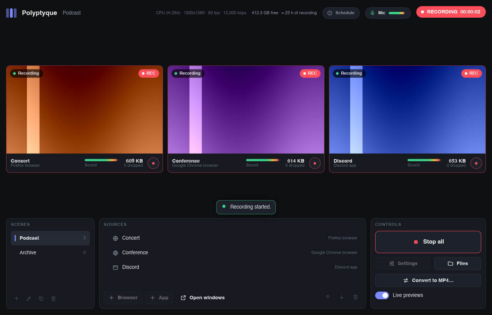

<p align="center">
  
</p>

<h1 align="center">Polyptyque</h1>

<p align="center">
  <strong>Record several windows at once, each in its own file, with its own sound.</strong><br>
  Built for multi-angle editing and archiving, over sessions that can run for twelve hours.
</p>

<p align="center">
  <strong>English</strong> · <a href="README.fr.md">Français</a>
</p>

<p align="center">
  
</p>

<!--
  Links pinned to the current beta: releases/latest/download/ ignores
  pre-releases and returns 404 until a stable version is published. For each
  new beta, update the tag and the version line (here and in README.fr.md).
  When 1.0.0 stable is out, switch to the permanent addresses:
  https://github.com/venaciteam/polyptyque/releases/latest/download/Polyptyque-Setup.exe
  https://github.com/venaciteam/polyptyque/releases/latest/download/Polyptyque-portable.zip
-->

## Download

**Windows 10 and 11** (64-bit), version 1.0 beta 5:

- **[Download the installer](https://github.com/venaciteam/polyptyque/releases/download/v1.0.0-beta.5/Polyptyque-Setup.exe)**: the standard version, installed like any other program. If in doubt, choose this one.
- **[Download the portable version](https://github.com/venaciteam/polyptyque/releases/download/v1.0.0-beta.5/Polyptyque-portable.zip)**: no installation, unzip it to any folder, even on a USB stick.

macOS and Linux: not available yet.

Requirements and the Windows warning on first launch: see [Installation](#installation).

---

## Contents

- [Why Polyptyque](#why-polyptyque)
- [Highlights](#highlights)
- [Lightweight by design](#lightweight-by-design)
- [Installation](#installation)
- [Getting started](#getting-started)
- [For editing](#for-editing)
- [Known limitations](#known-limitations)
- [Reporting a problem](#reporting-a-problem)
- [For developers](#for-developers)
- [License](#license)

## Why Polyptyque

Typical recording software composites several sources into a single picture and saves it as **one file** with **one audio mix**. Editing each source separately afterwards takes fragile plugins, and the sound stays mixed: two browser windows play through the same program, so they land on the same track.

Polyptyque works the other way around: **each window is recorded on its own**, in its own file, with **only its own sound**. Three windows make three files, on the same clock, ready to stack in a video editor.

## Highlights

**Each window’s sound, and nothing else**
- Every browser source has its own profile: sound from one Firefox tab doesn’t mix with another Firefox, or with Chrome or Discord.
- An app’s sound (Discord, a game, Tor Browser…) is captured at the source, without the rest of the system.
- Optional mic, in a separate file, which can be tested in Settings before recording.

**Files ready for editing**
- One file per source, all on a shared clock: picture and sound stay aligned from one file to the next.
- Constant frame rate, as video editors expect, even when a window doesn’t change.
- Lossless conversion to MP4, for Premiere Pro and other editors that struggle with MKV.

**Built for long sessions**
- Tested over 14 h 15 min of continuous recording with three sources: no dropouts, files aligned to within a few milliseconds, stable memory use.
- Files are written as they go: a crash only loses about one second, and a file cut off abruptly (power outage) stays playable.
- Disk space is monitored, with a clean stop if it runs out.
- Automatic sleep is blocked. Sleep that’s requested (closing the lid, power button) can’t be: the recording is then stopped cleanly, and Polyptyque offers to resume it on wake.
- If Windows shuts down or signs out during a recording, it says so and lets you cancel; otherwise the files are finalized before closing.

**Scheduled recordings**
- Start and end at set times, once or on specific days of the week: each scheduled recording starts a scene, including overnight (time slots that cross midnight) and across daylight saving time changes.
- While a scheduled recording is active, the computer and screen don’t go to sleep on their own. Polyptyque can start with Windows (minimized), so scheduled recordings survive a restart.
- Missed start (Polyptyque closed or computer asleep at the set time): when it’s back during the time slot, Polyptyque asks whether to start recording, and starts on its own after two minutes without an answer.
- A scheduled recording only stops what it started: a recording started by hand during a time slot is only stopped at the end time if you agree. Stopping a scheduled recording by hand asks for confirmation.

**Recovers from incidents**
- After a crash or power outage, Polyptyque checks the files at the next launch, offers to repair those that were cut off (losslessly) and to resume recording.
- If the encoder stops or freezes, Polyptyque restarts it on its own, in a new file, without interrupting the other sources.
- A window that’s closed or crashes turns black, then is reattached automatically as soon as it’s back. A browser closed by mistake reopens on its own; a minimized window comes back in one click, even if its screen was unplugged.
- External drive unplugged mid-recording: the rest is saved to `Videos\Polyptyque`.
- Settings are protected: previous version and daily backup, restored automatically if the file is damaged.

**It finds your windows**
- Browsers are recognized by their profile, not by their title, which changes with every tab.
- At launch, Polyptyque opens the current scene’s windows (can be turned off in Settings). The “Open windows” button opens them on demand, and each card’s button opens just one.
- When you quit Polyptyque, the source browsers close with it and get their tabs back at the next launch (can be turned off in Settings). Apps stay open.
- When a recording starts, Polyptyque reopens any missing windows: each browser comes back to its tabs, still signed in.

**Simple to use**
- Scenes (groups of sources), live previews of each source, global keyboard shortcuts.
- The same source in several scenes: copy and paste it (right-click, or <kbd>Ctrl</kbd> + <kbd>C</kbd> / <kbd>Ctrl</kbd> + <kbd>V</kbd>), or duplicate a whole scene. It’s the same window and, for a browser, the same sign-ins: nothing to set up again.
- Reorder sources by drag and drop, in the list or right in the preview grid (or with the arrows).
- Each source’s sound level is always shown, even when not recording: a silent source stands out before you start.
- One button to record everything, or one button per source to record a single source.
- Encoding on the graphics card (NVIDIA, AMD, Intel) when available, or on the CPU. If the card refuses one more encode (a GeForce limit, other software included), that source alone switches to the CPU.
- In English and French: Polyptyque follows the Windows display language (French if Windows is in French, English otherwise), and its clock follows the Windows regional format (12-hour or 24-hour). Both can be changed in Settings.

## Lightweight by design

Polyptyque has to run for hours alongside a game, a video call or several browsers, without slowing them down.

- **Native program**, written in [Rust](https://www.rust-lang.org): no embedded browser or web engine for the interface. The interface ([Slint](https://slint.dev)) is drawn directly.
- **The graphics card does the heavy lifting**:
  - window capture;
  - scaling and color conversion;
  - video encoding (NVENC, AMF, Quick Sync).
- **Nothing is recomputed for no reason**: a frame is only processed if the window has changed, and a repeated frame costs no memory copy.
- **Measured previews**: about ten frames per second, at a resolution matched to their size on screen, and a shortcut to turn them off.
- **One encoder per source**: each works independently, and a failure stays confined to its source.

## Installation

**Requirements**
- Windows 10 (version 2004 or later) or Windows 11, 64-bit.
- NVIDIA graphics card: driver 570 or later. AMD and Intel cards, or CPU encoding, work too.

**Install**
1. Download `Polyptyque-Setup.exe` from the [releases page](https://github.com/venaciteam/polyptyque/releases).
2. Run it: no questions, no administrator rights. Polyptyque opens when it’s done, with a shortcut on the desktop and in the Start menu.

> [!TIP]
> For long sessions, set the “active hours” of Windows Update (in its advanced options) to the time range when you record: Windows won’t restart on its own during those hours, unless an organization enforces an update. With scheduled recordings, also turn on “Start Polyptyque when Windows starts”.

> [!NOTE]
> Polyptyque isn’t digitally signed yet. Windows may show “Windows protected your PC”: click “More info”, then “Run anyway”.

**Updates**

Polyptyque checks for a new version at startup, then every six hours, and offers it in one click, never during a recording. In Settings, “Updates” lets you choose:
- **Stable versions**;
- **Stable and beta versions**: new features sooner, with more risk;
- **Don’t check**.

A beta copy gets the following betas by default, then the stable version. Switching back to stable versions doesn’t reinstall an older version: the beta stays until the next stable version.

**Uninstall**

Windows Settings > Apps. Scenes, settings and browser sign-ins are kept.

**Portable version**

`Polyptyque-portable.zip` runs without installation: unzip it anywhere (drive, USB stick), then run `Polyptyque.exe` at the root of the folder.
- Scenes, settings, browser sign-ins and logs are stored in the `données` subfolder (French for “data”). Nothing is written anywhere else on the PC: moving the folder, or copying it to another PC, takes everything with it.
- Recordings go to the folder chosen in Settings, or to `Videos\Polyptyque` if that folder doesn’t exist on this PC.

**Language and clock**

Polyptyque is in English and French, in a single version. It uses French if Windows is in French, and English for any other language; times follow the Windows regional format (12-hour or 24-hour). Settings > “Language” and “Clock” change them right away, without restarting.

## Getting started

1. **Add a browser source**: pick the browser, a name, and optionally an address. Polyptyque opens it with a profile of its own: sign in and set up your tabs. Everything is kept for next time.
2. **Add an app source**: pick an open window (Discord, a game, Tor Browser…).
3. **Reuse a source in another scene**: right-click the source > “Copy”, pick the other scene, then “Paste”. It’s the same source in both scenes, with the same sign-ins; removing it from one scene doesn’t remove it from the other. The “Duplicate scene” button does the same for all of a scene’s sources.
4. **Open windows**: at launch, Polyptyque opens the current scene’s windows by itself (browsers, and apps set to relaunch). The “Open windows” button in the sources panel does it on demand, and each card’s button opens a single source. Opening at launch can be turned off in Settings, as can closing browsers when you quit Polyptyque.
5. **Start recording**: Polyptyque finds or reopens any missing windows, then shows the status of each source.
6. **Stop all**: files are finalized cleanly. The round button on each preview starts or stops a single source.
7. **Schedule**: the “Schedule” button at the top opens scheduled recordings. For each one: the scene, the start and end times, once or on specific days. The button then shows the next time slot. Polyptyque has to stay open; the “Start Polyptyque when Windows starts” option is there too.
8. **Files**: by default in `Videos\Polyptyque` (the folder can be changed in Settings), one MKV file per source, named `date_time_scene_source.mkv` by default (`2026-10-20_14-32_Podcast_Discord.mkv`). The “Files” button opens this folder.

**Keyboard shortcuts**, active even when Polyptyque is in the background, and customizable in Settings:

| Shortcut | Action |
|---|---|
| <kbd>Ctrl</kbd> + <kbd>Shift</kbd> + <kbd>F9</kbd> | Start or stop recording |
| <kbd>Ctrl</kbd> + <kbd>Shift</kbd> + <kbd>F10</kbd> | Show or minimize Polyptyque |
| <kbd>Ctrl</kbd> + <kbd>Shift</kbd> + <kbd>F11</kbd> | Turn previews on or off |

In the Polyptyque window, <kbd>Ctrl</kbd> + <kbd>C</kbd> copies the selected source and <kbd>Ctrl</kbd> + <kbd>V</kbd> pastes it into the current scene.

## For editing

- **MKV or MP4**: while recording, Polyptyque writes MKV, a format that stays readable even after a power cut. “Convert to MP4…” creates an MP4 copy alongside, losslessly, and conversion can run automatically when a recording ends. The MKV is kept: plan for twice the disk space.
- **Mic**: its `…_Mic.mka` file becomes `…_Mic.m4a` after conversion.
- **Parts**: if the encoder was restarted, the rest of a source is in `…_part2.mkv`, to place right after the first part.
- **File cut off abruptly** (power outage): it plays, but without a duration or index. The repair offered at the next launch rebuilds them without re-encoding; converting to MP4 does too.
- **Source added mid-recording**: its file starts at the time shown in its name.

## Known limitations

- Sound is isolated **per program**, not per tab: all tabs in the same browser profile share one track. One browser source per piece of content to isolate gets around this.
- Windows stops drawing a window minimized to the taskbar: its picture freezes, and its card shows “Minimized”. The card’s “Restore window” button brings it back, even during a recording. A window hidden behind others records normally.
- Protected content (Netflix, Disney+…) often shows up black.
- Some games in exclusive fullscreen give a black picture: use “borderless windowed” mode instead.
- Scheduled recordings only start if Polyptyque is open and the computer is on: Windows doesn’t launch Polyptyque at the set time yet, or wake the computer from sleep. The console version has no scheduling.
- If a source’s browser has several windows, only the source’s window comes back at the next launch when Polyptyque closes them: Firefox and Chrome only reopen the last window closed. The others stay under “Recently closed windows” in the browser’s history.
- The console version (`polyptyque-console.exe`, shipped for diagnostics) is in French only for now.

The full list, technical choices and roadmap are in the [specification](docs/cahier-des-charges.md) (in French).

## Reporting a problem

Settings > “Report a problem…” (also offered after an interrupted recording) prepares a report file: version, Windows, graphics card, a summary of the settings without any paths, and the recent logs. Your user folder and Windows account name are masked. Polyptyque then shows the file in File Explorer and opens a pre-filled GitHub issue page: describe the problem there and attach the file, after reading it if you like. Polyptyque never sends anything by itself. Issues are public, and a GitHub account is required.

The report and logs are written in French, so that diagnostics stay searchable in a single language.

## For developers

**Layout**

| Folder | Role |
|---|---|
| `crates/polyptyque-core` | Scenes, sources, settings and their backups, naming, sync calculations, FFmpeg commands, portable version, current session log, scheduled recordings (time slots and decisions), reading the translation catalog; the `Platform` contract each system has to fulfill |
| `crates/polyptyque-windows` | Windows implementation: picture capture (Windows.Graphics.Capture) and sound capture (WASAPI), windows, browsers, pipes, single instance, sleep and session end, start with Windows, regional clock format |
| `crates/polyptyque-engine` | Recording sessions: shared clock, capture, monitored and restarted FFmpeg encoders, fallback folder, MP4 conversion and repair of files cut off abruptly |
| `crates/polyptyque-app` | Graphical interface: look in `ui/` (theme in `ui/theme.slint`), logic in `src/` (including the post-incident summary), updates, translations in `lang/` |
| `crates/polyptyque-cli` | Console version, shipped for diagnostics |
| `assets/logo` | Logo and icons, generated by `generer.py` |
| `docs` | Specification, risk analysis, test sheets and screenshots |

Only `polyptyque-windows` depends on the operating system: a port to macOS or Linux would mean writing its equivalent. Code comments and working documents are in French.

**Build and test**

```sh
cargo test --workspace                                    # tests, including simulated sessions (requires FFmpeg)
cargo build --release -p polyptyque-app -p polyptyque-cli
cargo run -p polyptyque-app                               # outside Windows: demo mode
```

The simulated sessions replay full recordings with fake windows and a real FFmpeg, and check:
- file durations and sync;
- MP4 conversion;
- recording source by source;
- recovery after a real FFmpeg crash or freeze, and repair of the file cut off abruptly;
- continuing the recording in the fallback folder when the chosen folder disappears;
- switching to the CPU when the graphics card refuses an encode.

Demo mode makes it possible to work on the interface without Windows. Environment variables simulate situations to test:

| Variable | Simulated situation |
|---|---|
| `POLYPTYQUE_DEMO_REDUITE` | The Discord window is minimized |
| `POLYPTYQUE_DEMO_PERDUE` | The Chrome window is closed |
| `POLYPTYQUE_DEMO_MISE_A_JOUR` | A new version is available |
| `POLYPTYQUE_LANG` | `fr` or `en`: stands in for the Windows language (interface set to Automatic, demo data) |

**Translations**

French is the source language, written in the code (`@tr()` in Slint, `tr!` in Rust). The English text lives in a gettext catalog, `crates/polyptyque-app/lang/en/LC_MESSAGES/polyptyque-app.po`, built into the executable. `cargo test -p polyptyque-app --test catalogue` fails if any text has no English version or if its placeholders don’t match; `POLYPTYQUE_CATALOGUE=maj` before the same command updates the catalogs. Terms and writing rules for English: [English glossary](docs/lexique-anglais.md) (in French).

## License

Polyptyque is free software, under the [GPL v3 or later](LICENSE). It relies on:
- [FFmpeg](https://ffmpeg.org), shipped alongside under its own GPL license;
- [Slint](https://slint.dev);
- [Velopack](https://velopack.io);
- Microsoft’s [`windows`](https://github.com/microsoft/windows-rs) crate.
