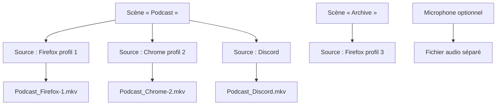
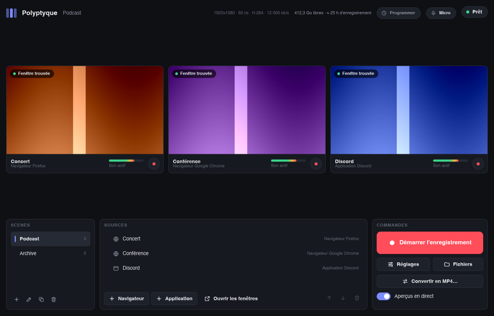
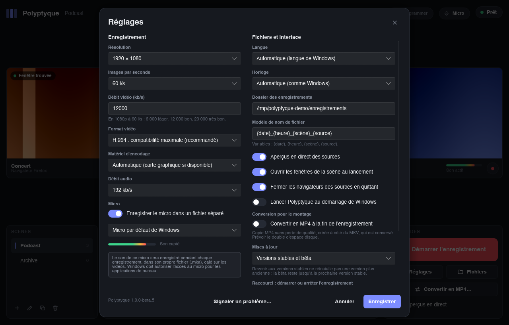
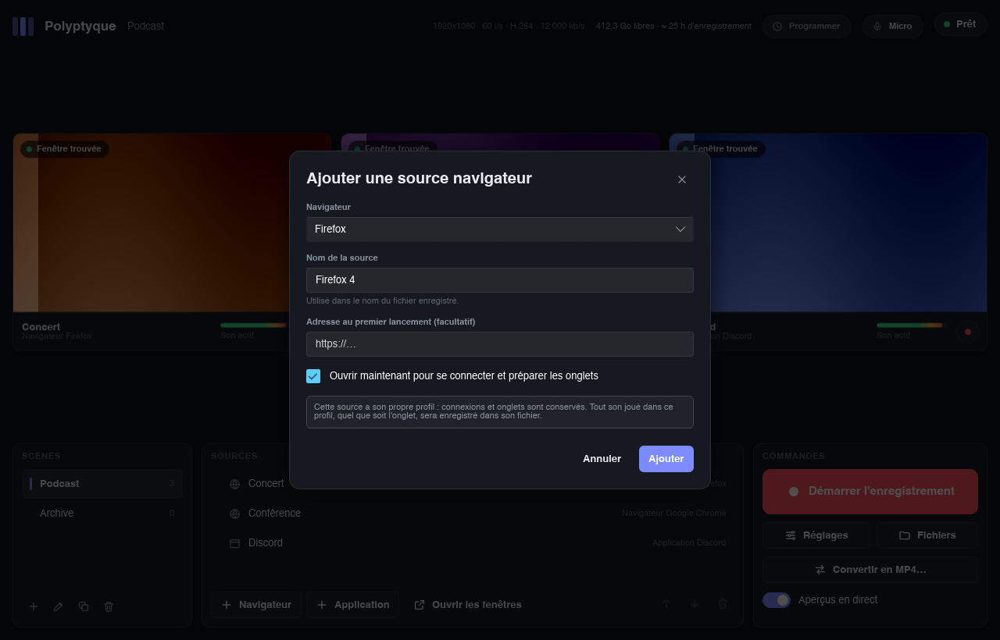
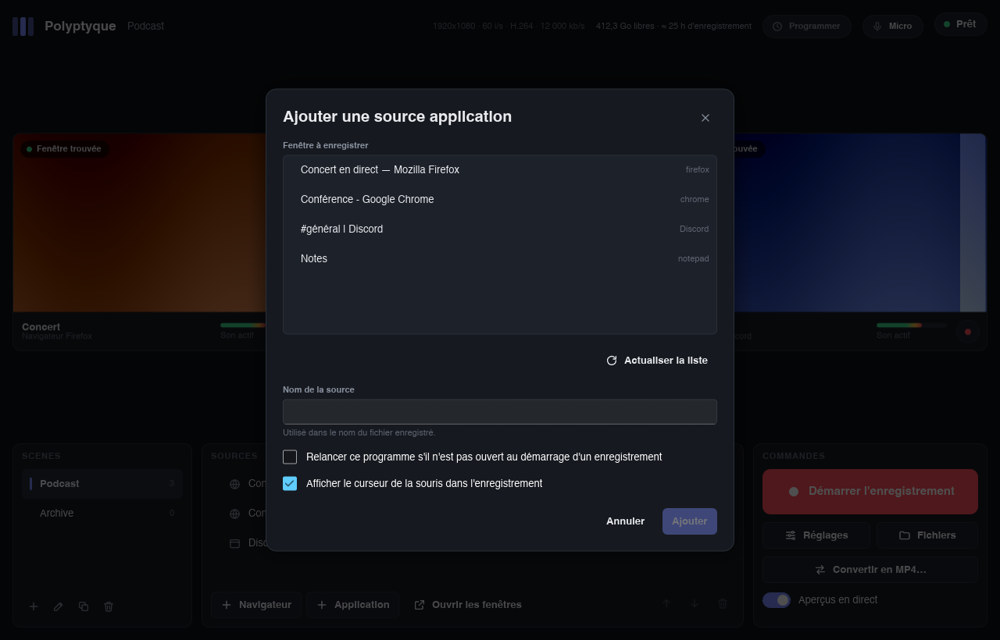
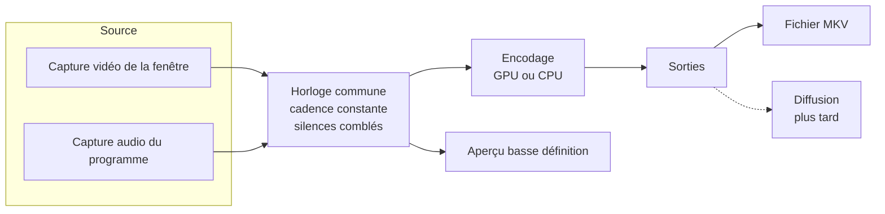

# Polyptyque - Cahier des charges

> [!abstract] Résumé
> Polyptyque est un logiciel d'enregistrement multi-sources. Il capture en même temps plusieurs fenêtres (navigateurs, applications, jeux) et enregistre chacune, avec **son propre son isolé**, dans un **fichier MKV distinct**.
> Usages visés : montage multi-angle et archivage, sur des sessions pouvant durer **jusqu'à 12 heures**.
> Plateforme : Windows d'abord, architecture prévue dès le départ pour un portage macOS et Linux.
> Priorité absolue : **fiabilité**, puis performance, puis simplicité d'usage.

## Table des matières

1. [[#Contexte et objectifs]]
	1. [[#Besoin]]
	2. [[#Priorités]]
2. [[#Périmètre]]
	1. [[#Inclus dans la version 1]]
	2. [[#Exclus de la version 1]]
3. [[#Concepts]]
4. [[#Exigences fonctionnelles]]
	1. [[#Scènes]]
	2. [[#Sources navigateur]]
	3. [[#Sources application]]
	4. [[#Reconnaissance et restauration des fenêtres]]
	5. [[#Enregistrement]]
	6. [[#Programmation des enregistrements]]
	7. [[#Microphone]]
	8. [[#Fichiers de sortie et nommage]]
	9. [[#Conversion MKV vers MP4]]
	10. [[#Réglages d'encodage]]
	11. [[#Interface]]
	12. [[#Langues et formats]]
	13. [[#Signalement d'un problème]]
	14. [[#Raccourcis clavier]]
	15. [[#Pilotage par d'autres programmes]]
	16. [[#Préparation de la diffusion en direct]]
	17. [[#Installation]]
5. [[#Exigences non fonctionnelles]]
	1. [[#Fiabilité]]
	2. [[#Performance]]
	3. [[#Compatibilité]]
	4. [[#Sécurité et vie privée]]
	5. [[#Distribution et licence]]
6. [[#Limites connues]]
7. [[#Architecture technique]]
	1. [[#Chaîne de traitement]]
	2. [[#Découpage du code]]
	3. [[#Technologies]]
	4. [[#Portage macOS et Linux]]
8. [[#Feuille de route]]
9. [[#Journal des décisions]]
10. [[#Questions ouvertes]]
11. [[#Sources]]

---

## Contexte et objectifs

### Besoin

[[OBS Studio]] n'enregistre qu'**un seul fichier à la fois** : toutes les sources sont mélangées dans une seule image et un seul son. Le besoin est l'inverse :

- capturer plusieurs fenêtres en parallèle (par exemple trois fenêtres de navigateur) ;
- produire **un fichier par fenêtre** ;
- dans chaque fichier, **uniquement le son émis par cette fenêtre**, ni le son du système, ni celui des autres fenêtres.

Les fenêtres capturées doivent être **reconnues de façon fiable** d'une session à l'autre, et rouvertes automatiquement si elles ne le sont pas.

### Priorités

| Rang | Priorité | Traduction concrète |
|---|---|---|
| 1 | Fiabilité | 12 h d'enregistrement sans perte, fichiers toujours lisibles, même après un plantage |
| 2 | Performance | Encodage par la carte graphique dès que possible, impact minimal sur la machine |
| 3 | Simplicité | Interface proche d'[[OBS Studio]] mais allégée, centrée sur le multi-enregistrement |
| 4 | Compatibilité | Fonctionner sur le plus grand nombre de machines Windows, avec dégradation propre |

---

## Périmètre

### Inclus dans la version 1

- Sources de type **navigateur géré** (profil dédié par source) et **application** (fenêtre quelconque).
- Plusieurs **scènes**, au sens de groupes de sources, verrouillées pendant l'enregistrement.
- Un **fichier MKV par source**, vidéo et son dans le même fichier.
- **Microphone** optionnel, enregistré dans un fichier séparé.
- **Conversion MKV vers MP4** sans perte.
- **Aperçu en direct** de toutes les sources en même temps.
- Réglages d'encodage, nommage des fichiers, raccourcis clavier.

### Exclus de la version 1

> [!info] Hors périmètre, mais anticipé
> - **Diffusion en direct** (streaming) : non développée, mais l'architecture est prévue pour l'ajouter plus tard. Si elle est ajoutée, elle sera gratuite.
> - **Portage macOS et Linux** : seul le module de capture sera à réécrire (voir [[#Portage macOS et Linux]]).

> [!failure] Abandonné
> - **Transitions et fichier « programme »** à la façon d'OBS : abandonnés. Dans Polyptyque, chaque source a son propre fichier, une transition entre scènes n'y aurait aucun sens.
> - **Composition** (placer et redimensionner plusieurs sources dans une même image) : abandonnée pour la même raison.
> - **Navigateur intégré** : écarté. Il ne couvrirait ni Discord, ni les jeux, ni Tor. Il imposerait de maintenir un moteur de navigation à jour (sécurité) et ferait perdre à l'utilisateur ses navigateurs, extensions et gestionnaires de mots de passe.
> - **Extension de navigateur** : écartée. La capture audio par onglet n'existe que sous Chromium, pas sous Firefox.

---

## Concepts



| Concept | Définition |
|---|---|
| **Scène** | Groupe nommé de sources, correspondant à un usage (« Podcast », « Archive »…). Une seule scène est active à la fois. |
| **Source** | Une fenêtre capturée avec son son isolé. Produit un fichier. Une même source peut figurer dans plusieurs scènes. |
| **Source navigateur** | Navigateur lancé par Polyptyque avec un profil qui lui est dédié. |
| **Source application** | Toute autre fenêtre : Discord, jeu, Tor Browser, logiciel quelconque. |
| **Profil dédié** | Dossier de profil de navigateur propre à une source. Il conserve connexions, cookies et onglets. |
| **Enregistrement** | Période pendant laquelle les sources de la scène active écrivent leurs fichiers. |

---

## Exigences fonctionnelles

### Scènes

- Créer, renommer, dupliquer, supprimer des scènes.
- Une scène contient une liste ordonnée de sources.
- **Verrouillage pendant l'enregistrement** : tant qu'au moins une source enregistre, il est impossible de :
	- changer de scène ;
	- ajouter, coller, supprimer ou réordonner une source ; dupliquer une scène ;
	- modifier les réglages d'encodage.
- La scène active à la fermeture est rouverte au lancement suivant.

**Une source dans plusieurs scènes** (copier-coller **par référence**) :
- **Copier** la source sélectionnée (clic droit > « Copier », ou <kbd>Ctrl</kbd> + <kbd>C</kbd>), choisir une autre scène, puis **coller** (clic droit dans la liste > « Coller », ou <kbd>Ctrl</kbd> + <kbd>V</kbd>) : la source est ajoutée à la fin de la scène en cours.
- C'est **la même source** dans les deux scènes, pas une copie : même fenêtre, et pour un navigateur même profil, donc mêmes connexions et mêmes onglets. La modifier dans une scène la modifie partout. Seul l'ordre des sources est propre à chaque scène.
- **Jamais deux fois la même source dans une scène** (même programme, donc même son) : le collage est alors refusé, avec une explication.
- **Supprimer** une source ne la retire que de la scène en cours ; la confirmation indique les autres scènes où elle reste. Retirée de sa dernière scène, elle disparaît (son profil de navigateur reste sur le disque, comme pour toute suppression). Supprimer une scène supprime les sources qui ne sont dans aucune autre scène.
- **Dupliquer une scène** (nom proposé : « Podcast (copie) ») : la nouvelle scène reprend les mêmes sources, par référence et dans le même ordre, et devient la scène en cours. Les programmations ne sont pas reprises.
- Une source partagée l'indique dans la liste des sources (« Navigateur Firefox · 2 scènes »).
- Copier reste possible pendant un enregistrement (rien ne change) ; coller et dupliquer sont bloqués, comme l'ajout d'une source.
- Le presse-papiers est interne à Polyptyque : rien n'est copié dans celui de Windows. Les raccourcis agissent dans la fenêtre principale, pas dans les fenêtres de réglages (leurs champs de texte gardent leurs propres raccourcis).

> [!note] Rangement dans les réglages
> Depuis la version 2 du fichier de réglages, les sources sont rangées une seule fois (`[[sources]]`) et chaque scène ne garde que la liste ordonnée de leurs identifiants. Le dossier de profil (`profils/<identifiant>`) reste donc unique, quel que soit le nombre de scènes. Un fichier de la version 1 (sources rangées dans chaque scène) est converti au chargement, sans rien perdre ; la version précédente reste dans `config.toml.precedent`.

### Sources navigateur

- **Détection des navigateurs installés** via la liste tenue par Windows (registre `StartMenuInternet`), plus la possibilité d'indiquer un exécutable à la main.
- **Choix du navigateur** à la création de chaque source.
- Familles gérées (chaque navigateur sera vérifié individuellement) :

| Famille | Exemples | Lancement avec profil dédié |
|---|---|---|
| Gecko (Firefox) | Firefox, LibreWolf, Waterfox, Zen, Floorp | `-profile "<dossier>" -no-remote` |
| Chromium | Chrome, Edge, Brave, Vivaldi, Opera | `--user-data-dir="<dossier>"` |

- **Un profil dédié par source**, stocké dans le dossier de données de Polyptyque (`%LOCALAPPDATA%\Polyptyque\profils\<identifiant>`), commun à toutes les scènes où figure la source.
- **Connexions conservées** : le profil est permanent, l'utilisateur ne se connecte qu'une fois par profil.
- **Restauration des onglets** : Polyptyque configure le profil pour rouvrir les onglets de la session précédente (Firefox : préférence `browser.startup.page = 3` ; Chromium : option de lancement `--restore-last-session`).
- **Adresse de départ** optionnelle, utilisée au premier lancement du profil.

> [!warning] Règle d'or des profils
> Le son est isolé **par profil**, pas par onglet. Tout son joué dans n'importe quel onglet ou fenêtre d'un profil se retrouve dans le fichier de la source correspondante. Une source = un profil = uniquement ce qui doit être entendu.

> [!note] Tor Browser
> Tor Browser est traité comme une **source application** : capture de sa fenêtre et de son son (isolé, car il tourne comme un programme séparé), **sans** profil géré ni connexion conservée. C'est le fonctionnement voulu par Tor (effacement à la fermeture).

### Sources application

- Sélection d'une fenêtre ouverte dans une liste (titre, icône, nom du programme).
- Informations mémorisées : chemin de l'exécutable, classe de fenêtre, titre de la fenêtre, arguments de lancement éventuels.
- **Relance automatique** optionnelle, réglable par source (utile pour Discord, pas toujours souhaitable pour un jeu lancé depuis Steam).
- Option par source : afficher ou non le curseur de la souris (affiché par défaut).

### Reconnaissance et restauration des fenêtres

Au lancement de Polyptyque (réglage « Ouvrir les fenêtres de la scène au lancement », activé par défaut), avec le bouton « Ouvrir les fenêtres » du panneau des sources, et au démarrage d'un enregistrement, pour chaque source de la scène en cours (un changement de scène n'ouvre rien) :

1. **Source navigateur** : recherche du processus dont la ligne de commande contient le dossier du profil dédié. S'il existe, sa fenêtre principale est rattachée ; sinon, le navigateur est relancé avec ce profil.
2. **Source application** : recherche par ordre de précision décroissante :
	1. même exécutable, même classe et même titre ;
	2. même exécutable et même classe ;
	3. même exécutable, si une seule fenêtre correspond ;
	4. sinon : relance (si activée).
	
	En cas d'ambiguïté, la fenêtre utilisée le plus récemment est retenue, sans question (à revoir si des erreurs de reconnaissance apparaissent).
3. Chaque source affiche son état : **connectée**, **en attente**, **introuvable**.

> [!tip] Pourquoi c'est fiable pour les navigateurs
> L'identifiant d'une fenêtre change à chaque ouverture, et le titre d'une fenêtre de navigateur change avec l'onglet affiché. Le dossier de profil, lui, ne change jamais : c'est la clé de reconnaissance.

**Fermeture avec Polyptyque** (réglage « Fermer les navigateurs des sources en quittant », activé par défaut) : en quittant Polyptyque, toutes les fenêtres des profils dédiés, toutes scènes confondues, reçoivent une demande de fermeture, comme un clic sur leur croix. Le navigateur enregistre sa session (onglets rouverts au lancement suivant) et peut demander confirmation pour une page non enregistrée. Les applications ne sont jamais fermées, ni le navigateur personnel (autre profil, autre processus).
- Un navigateur ne rouvre que la **dernière fenêtre fermée** de son profil : la fenêtre de la source est fermée en dernier, les autres restent dans « Fenêtres récemment fermées ».
- Rien n'est fermé à la fermeture de la session Windows (Windows ferme lui-même les navigateurs, s'en mêler ferait perdre des fenêtres), ni au redémarrage pour une mise à jour, ni après un plantage.

### Enregistrement

- **Bouton global** : démarre toutes les sources de la scène active **au même instant**, sur une **horloge commune**.
- **Enregistrement individuel** : chaque source peut aussi être démarrée ou arrêtée seule, par le bouton de sa carte.
	- Hors enregistrement, le bouton d'une carte démarre cette seule source.
	- Pendant un enregistrement, une source arrêtée est finalisée en arrière-plan pendant que les autres continuent ; une source ajoutée en cours de route commence un **nouveau fichier**, nommé d'après son heure de départ.
	- Arrêter la dernière source termine l'enregistrement. Le bouton principal devient « Tout arrêter ».
- **Cadence constante** : Windows n'envoie une image que lorsque la fenêtre change ; Polyptyque répète la dernière image pour garantir une cadence fixe (indispensable aux logiciels de montage).
- **Son continu** : les silences sont comblés pour que le son reste calé sur l'image.
- **Fenêtre perdue** (fermée, plantée) : le fichier continue avec une **image noire et du silence** ; la source est **rattachée automatiquement** dès que la fenêtre réapparaît.
	- Bouton **« Rouvrir la fenêtre »** sur la carte, y compris pendant l'enregistrement.
	- **Réouverture automatique** après 20 s pour les navigateurs et les applications dont la relance est activée : trois essais par disparition, dix par enregistrement. Firefox encore en train de se fermer ou de redémarrer n'est pas relancé (il afficherait « Firefox est déjà ouvert »).
- **Fenêtre réduite** : Windows ne la dessine plus, l'image se fige ; un avertissement s'affiche, avec un bouton **« Rétablir la fenêtre »** qui la fait revenir sans lui donner le focus et la replace sur l'écran principal si elle n'est plus sur aucun écran (écran débranché).
- **Fenêtre redimensionnée** : la résolution du fichier reste fixe, l'image est mise à l'échelle en conservant ses proportions, avec des bandes noires si besoin.
- **Mise en veille automatique de Windows empêchée** pendant l'enregistrement. Une mise en veille demandée (capot, bouton, menu) ne peut pas l'être : Windows prévient quelques secondes avant, l'enregistrement est arrêté proprement, et sa reprise est proposée au réveil (voir B3 dans l'[[analyse-des-risques|analyse des risques]]).
- **Encodeur de la carte graphique refusé** (limite d'encodages simultanés des cartes GeForce, autres logiciels compris ; pilote) : la source passe seule sur le processeur, dans une nouvelle partie, avec un message.
- **Encodeur arrêté ou figé** (plantage de FFmpeg, pilote, 30 s sans avancer) : la capture continue et un nouvel encodeur reprend dans un nouveau fichier `…_partie2.mkv`, image et son recalés au même instant. Trois échecs d'affilée dès le démarrage arrêtent la source, pour ne pas tourner en boucle.
- **Dossier d'enregistrement inaccessible** (disque externe débranché, autre PC) : au démarrage comme en cours de route, la suite est enregistrée dans `Vidéos\Polyptyque`, avec un message.
- **Erreur interne** dans la capture d'une source : la capture est relancée au même point de l'horloge (image et son restent calés) ; au-delà de trois relances, la source passe en erreur, sans toucher aux autres.
- **Enregistrement interrompu** (plantage, coupure de courant, écran bleu) : au lancement suivant, une fenêtre « Enregistrement interrompu » fait le bilan des fichiers et propose de **réparer** ceux qui ont été coupés net (durée et index reconstruits sans réencodage, original remplacé après vérification) et de **reprendre l'enregistrement**.
- **Une seule copie** de Polyptyque à la fois : un second lancement ramène la fenêtre déjà ouverte.
- **Arrêt, redémarrage ou déconnexion de Windows** pendant un enregistrement : Polyptyque le signale à Windows, qui l'affiche dans son écran d'arrêt et permet d'annuler. Si l'arrêt continue malgré tout, les fichiers sont finalisés avant la fermeture. Un arrêt critique (batterie épuisée) n'est jamais bloqué.

### Programmation des enregistrements

- **Programmation** : lance une scène (toutes ses sources) de l'heure de début à l'heure de fin, à la minute près.
	- Répétition : **une seule fois** (une date), ou **chaque semaine certains jours** (les sept : tous les jours). Les jours désignent le jour où le créneau commence.
	- Une heure de fin antérieure ou égale à l'heure de début désigne **le lendemain** : un créneau 22:00 → 02:00 passe minuit. Un début égal à la fin est refusé (pas de créneau de 24 h).
	- Heures et dates affichées et saisies selon [[#Langues et formats]] : réglage « Horloge » (24 h ou 12 h), date choisie dans trois listes jour, mois, année.
	- Activer, désactiver, modifier, supprimer. Supprimer une scène supprime ses programmations (la confirmation le dit).
	- Une programmation dont l'enregistrement est en cours ne peut être ni modifiée ni supprimée avant la fin de son créneau.
- **Un seul enregistrement à la fois** : deux programmations activées qui se chevauchent sont refusées, avec le nom de l'autre. Des créneaux bout à bout (l'un finit à 22:00, l'autre commence à 22:00) sont acceptés : le second démarre dès que les fichiers du premier sont finalisés.
- **Accès** : pastille de la barre du haut, qui affiche « Programmer », le prochain créneau (« Podcast · aujourd'hui à 21:00 ») ou la fin prévue de l'enregistrement programmé (« Arrêt programmé à 22:00 »). Un clic ouvre la liste des programmations (avec le prochain créneau de chacune), d'où l'on crée et modifie.
- **Polyptyque doit être ouvert** : il n'y a pas encore de lancement par Windows à l'heure prévue.
	- Tant qu'une programmation est **active** (un créneau en cours ou à venir), la mise en veille automatique et l'extinction de l'écran sont empêchées, par le même mécanisme que pendant l'enregistrement mais indépendamment de lui (la fin d'un enregistrement ne lève pas cette protection). Une mise en veille demandée (capot, bouton) reste possible.
	- Fermer la fenêtre alors qu'une programmation doit encore lancer un enregistrement (ou arrêter celui en cours) : voir **Arrière-plan** ci-dessous.
- **Arrière-plan** : fenêtre cachée (absente de la barre des tâches), icône de Polyptyque dans la zone de notification, près de l'horloge (sous la flèche « ^ » si Windows l'y range). Les programmations, les raccourcis globaux, l'anti-veille et l'enregistrement en cours continuent ; les aperçus et les niveaux sonores des cartes s'arrêtent jusqu'au retour de la fenêtre.
	- Icône : un clic fait revenir la fenêtre ; clic droit : « Afficher Polyptyque », « Quitter Polyptyque ». Info-bulle : « Polyptyque », « Enregistrement en cours » le cas échéant, et le texte de la pastille de la programmation (« Podcast · demain à 07:00 »). L'icône n'existe que pendant l'arrière-plan ; elle est reposée si l'Explorateur redémarre.
	- La fenêtre revient aussi avec le raccourci « Afficher / réduire Polyptyque », un second lancement de Polyptyque (raccourci du bureau, menu Démarrer) et toute question qui doit se voir (démarrage manqué).
	- **Fermer la fenêtre** (croix, <kbd>Alt</kbd> + <kbd>F4</kbd>, « Fermer la fenêtre » de la barre des tâches) alors qu'une programmation a encore besoin de Polyptyque, selon le réglage « Fermer la fenêtre avec une programmation prévue » (Fichiers et interface) :
		- **Demander à chaque fois** (par défaut) : fenêtre « Programmation active » (« « Podcast » est programmé demain à 07:00 : Polyptyque doit rester ouvert pour le lancer. Il peut continuer en arrière-plan, avec son icône près de l'horloge. »), boutons Annuler / Quitter quand même / **Continuer en arrière-plan**, case « Se souvenir de mon choix » (« Modifiable ensuite dans les réglages. ») qui enregistre le choix dans le réglage ;
		- **Continuer en arrière-plan** : directement, sans question, y compris pendant un enregistrement (rien n'est interrompu) ;
		- **Quitter Polyptyque** : sans avertissement pour les programmations.
	- Sans programmation qui attend, la croix ferme Polyptyque comme avant, quel que soit le réglage. Un enregistrement ou une conversion en cours demande toujours confirmation avant de quitter, quel que soit le réglage (sauf « Continuer en arrière-plan », qui ne quitte pas).
	- **« Quitter Polyptyque »** (icône) : quitte pour de bon. Une programmation qui attend demande confirmation (« … Quitter quand même ? »), sauf réglage « Quitter Polyptyque » ; la fenêtre revient pour toute confirmation.
- **Lancer Polyptyque au démarrage de Windows** (option, dans les programmations et dans les réglages, désactivée par défaut) : sans elle, les programmations ne survivent pas à un redémarrage (mise à jour de Windows).
	- Inscription dans la liste « Applications au démarrage » de l'utilisateur (`HKCU\Software\Microsoft\Windows\CurrentVersion\Run`), sans droits administrateur. Lancé ainsi, Polyptyque démarre **en arrière-plan** (icône près de l'horloge), sans ouvrir les fenêtres de la scène : elles s'ouvrent au début du créneau, comme pour tout enregistrement.
	- L'emplacement inscrit est remis à jour à chaque lancement (version portable déplacée) ; l'inscription est retirée à la désinstallation.
	- Désactivé par l'utilisateur dans les Paramètres de Windows (Applications > Démarrage) : signalé dans la fenêtre des programmations. Réactiver l'option dans Polyptyque lève cette désactivation.
	- Version portable : seule exception à « rien n'est écrit ailleurs sur le PC », signalée sous l'option.

> [!important] Principe
> La programmation n'arrête que l'enregistrement **dont elle a la charge** : celui qu'elle a lancé (à l'heure prévue, ou après un démarrage manqué), ou celui lancé à la main dont l'utilisateur a accepté l'arrêt automatique. Jamais un autre.

| Situation | Comportement |
|---|---|
| Début d'un créneau, rien n'enregistre | La scène du créneau devient la scène en cours et s'enregistre. Message : « Enregistrement programmé : arrêt prévu à 22:00 » |
| **Démarrage manqué** : Polyptyque fermé ou ordinateur en veille à l'heure prévue, ouvert pendant le créneau | Fenêtre « Enregistrement programmé » : lancer maintenant, jusqu'à la fin du créneau ? Compte à rebours de **deux minutes** ; sans réponse, l'enregistrement démarre (Polyptyque relancé seul après une mise à jour de Windows, sans personne devant). La fenêtre réduite ou en arrière-plan revient à l'écran. Sans objet si le créneau se termine avant |
| Créneau commencé il y a moins de 30 s (Polyptyque ouvert juste après l'heure) | Démarrage direct, sans question |
| Programmation créée, modifiée ou activée pendant son propre créneau | Question du démarrage manqué, plutôt qu'un démarrage d'office |
| **Enregistrement lancé à la main** pendant un créneau (bouton, raccourci, carte d'une source) | Fenêtre : « Arrêter automatiquement cet enregistrement à 22:00 ? » Compte à rebours de deux minutes ; sans réponse, **pas d'arrêt automatique** (le lancement peut n'avoir rien à voir avec la programmation). Dans les deux cas, la programmation ne lance plus rien dans ce créneau |
| **Enregistrement manuel déjà en cours** au début d'un créneau | Petite fenêtre d'information. L'enregistrement continue tel quel ; la programmation ne lance rien et ne l'arrête pas en fin de créneau, même s'il est arrêté entre-temps |
| **Arrêt à la main** d'un enregistrement dont la programmation a la charge (bouton, raccourci, dernière source, quitter) | Confirmation : « Un créneau d'enregistrement programmé est en cours… » Si oui, arrêt, sans relance dans ce créneau, même après une fermeture de Polyptyque ; les créneaux suivants restent prévus |
| Arrêt à la main d'un enregistrement que la programmation ignore | Comme sans programmation, sans confirmation |
| Fin du créneau | Arrêt de l'enregistrement dont la programmation a la charge : « Fin du créneau programmé. » |
| Arrêt imposé (disque presque plein) ou démarrage impossible (scène vide, encodeur) | Message, et pas de nouvel essai dans ce créneau |
| Plantage, coupure, arrêt ou redémarrage de Windows, mise en veille forcée pendant un enregistrement programmé | Le créneau reste à reprendre : au retour (dans le créneau), question du démarrage manqué, donc reprise automatique après deux minutes. La mise en veille ne propose pas en plus « Reprendre l'enregistrement ? » |

- **Changements d'heure** : les heures sont celles de l'horloge affichée par Windows. La nuit du passage à l'heure d'hiver, un créneau 01:00 → 04:00 dure réellement 4 h ; celle du passage à l'heure d'été, 2 h. Comme dans les agendas (RFC 5545), une heure qui n'existe pas (02:30 au passage à l'heure d'été) est décalée de la durée du saut (03:30), et une heure qui existe deux fois (02:30 au passage à l'heure d'hiver) est prise à sa première occurrence. Un créneau qui deviendrait vide (02:15 → 03:00 la nuit du passage à l'heure d'été) n'a pas lieu cette nuit-là. L'enregistrement lui-même reste sur son horloge interne (B9 de l'[[analyse-des-risques|analyse des risques]]).
- **Mémoire des créneaux** : les créneaux « réglés » (refusés, arrêtés à la main, impossibles, occupés par un enregistrement manuel) sont gardés dans `programmations-etat.toml` (dossier des données locales, ou `données` en version portable), effacés une fois leur créneau passé. Un créneau interrompu malgré l'utilisateur n'y figure pas : c'est ce qui permet de le reproposer.
- Tout est noté dans le journal (démarrages, questions et réponses, arrêts, anti-veille).

> [!todo] À tester sur la machine de référence
> Démarrage d'un enregistrement programmé avec la session verrouillée et l'écran éteint (capture d'une fenêtre dans ces conditions, connexion automatique de Windows après une mise à jour). Fiche : [[protocole-test-programmation]].

> [!info] Plus tard
> - Lancement par Windows à l'heure prévue, même logiciel fermé (Planificateur de tâches).
> - Sortie de veille automatique à l'heure prévue (minuteries de réveil).

### Microphone

- **Désactivé par défaut.**
- Activation dans les réglages, avec **demande de confirmation explicite** à l'utilisateur, en respectant les autorisations de confidentialité de Windows.
- Choix du périphérique d'entrée.
- Choix du micro par défaut de Windows ou d'un micro précis ; un micro choisi puis débranché reste mémorisé et proposé.
- Enregistré dans un **fichier audio séparé**, sur la même horloge que les vidéos, pendant toute la durée de l'enregistrement.
- Micro débranché puis rebranché : repris automatiquement (silence en attendant).
- Accès refusé par Windows (réglage de confidentialité) : détecté et expliqué, avec un raccourci vers le bon écran des Paramètres.
- **Test dans les réglages** : sous la liste des micros, un indicateur de niveau montre si le micro choisi capte du son (avant même d'enregistrer les réglages) ; une erreur d'accès s'y affiche directement. Le micro n'est écouté que pendant que les réglages sont ouverts avec le micro activé : jamais en permanence, pour que l'icône « micro utilisé » de Windows ne reste pas allumée.

> [!info] Format du fichier micro
> Pendant l'enregistrement : Matroska audio (`…_Micro.mka`, son AAC), avec la même robustesse que les vidéos. Le WAV classique était exclu : limité à 4 Go, soit environ 6 h en stéréo 48 kHz 16 bits.
> Pour le montage : la conversion produit un `.m4a`, lu par la plupart des logiciels de montage.

### Fichiers de sortie et nommage

- **Un fichier MKV par source**, vidéo et son dans le même fichier.
- **Dossier de sortie** configurable.
- **Nom de chaque source** défini par l'utilisateur.
- **Modèle de nom commun**, avec variables :

| Variable | Exemple |
|---|---|
| `{date}` | `2026-10-20` |
| `{heure}` | `14h32` |
| `{scène}` | `Podcast` |
| `{source}` | `Discord` |

- Modèle par défaut : `{date}_{heure}_{scène}_{source}` → `2026-10-20_14h32_Podcast_Discord.mkv` (en anglais : `{date}_{time}_{scene}_{source}` → `2026-10-20_14-32_Podcast_Discord.mkv`, voir [[#Langues et formats]])
- **Aucun écrasement** : si le fichier existe, un suffixe numérique est ajouté.
- Après une relance de l'encodeur, la suite est dans `…_partie2.mkv`, `…_partie3.mkv`, etc. Le titre inscrit dans le fichier indique le moment de la reprise.
- Le micro est enregistré dans `…_Micro.mka` (variable `{source}` remplacée par « Micro »).
- **Découpage automatique** optionnel (toutes les N heures ou N Go), désactivé par défaut.

### Conversion MKV vers MP4

Le MKV est utilisé pendant l'enregistrement pour sa robustesse : un fichier MKV interrompu reste lisible, un MP4 interrompu est souvent perdu. Certains logiciels de montage ([[Premiere Pro]] notamment) gèrent mal le MKV, d'où une fonction de conversion.

- **Conversion sans réencodage** (« remuxage ») : les données vidéo et audio sont recopiées telles quelles dans un conteneur MP4. Aucune perte de qualité, opération rapide.
- Déclenchement :
	- **manuel** : sélection d'un ou plusieurs fichiers ;
	- **automatique** (option) : conversion à la fin de chaque enregistrement, en conservant le MKV d'origine.
- Vérification de la conversion (durée, pistes) avant de la déclarer réussie ; en cas d'échec ou d'annulation, le fichier partiel est effacé.
- Les fichiers de son seul (`.mka`) sont convertis en `.m4a` ; le HEVC reçoit l'étiquette `hvc1` attendue par la plupart des logiciels.
- Espace disque vérifié avant chaque fichier (la copie double la place occupée).
- Conversion en arrière-plan, un fichier à la fois : une pastille indique l'avancement, un clic permet d'annuler, et un enregistrement peut démarrer pendant ce temps.

> [!warning] À vérifier en test
> Certains utilisateurs signalent des craquements audio après un remuxage. La conversion devra être validée sur de longs fichiers, dans [[Premiere Pro]] et [[DaVinci Resolve]].

### Réglages d'encodage

Réglages **communs à toutes les sources** dans la version 1.

| Réglage | Valeurs | Défaut |
|---|---|---|
| Matériel d'encodage | Automatique, carte graphique (GPU), processeur (CPU) | Automatique (GPU si disponible) |
| Encodeur | Détecté : NVIDIA NVENC, AMD AMF, Intel Quick Sync, logiciel | Le meilleur disponible |
| Codec | H.264, HEVC (selon le matériel) | H.264 (compatibilité maximale au montage) |
| Résolution | 720p, 1080p, 1440p, 2160p, personnalisée | 1080p |
| Images par seconde | 24, 25, 30, 50, 60, personnalisé | 60 |
| Contrôle du débit | Débit constant (CBR), débit variable (VBR), qualité constante | À définir |
| Débit vidéo | En kb/s | À définir après mesures (piste : 12 000 kb/s en 1080p60) |
| Préréglage | Vitesse ↔ qualité | Équilibré |
| Audio | AAC 48 kHz stéréo, débit en kb/s | 192 kb/s |

> [!info] Estimation d'espace disque
> À 12 000 kb/s, une source occupe environ **5,4 Go par heure**, soit environ **65 Go en 12 h** ; trois sources occupent environ **195 Go**.

### Interface

Inspirée d'[[OBS Studio]], volontairement allégée, thème sombre.

> [!important] Exigences de conception
> - **Légèreté** : l'interface ne doit pas alourdir le logiciel. Pas de page web embarquée ; une interface native dessinée par la carte graphique.
> - **Épurée et esthétique** : peu d'éléments à l'écran, hiérarchie claire.
> - **Facilement remplaçable** : l'apparence est décrite dans des fichiers séparés de la logique, et l'interface ne communique avec le moteur que par une interface de programmation unique (démarrer, suivre, arrêter). Changer l'apparence, voire toute l'interface, ne touche pas au moteur.

```text
┌────────────────────────────────────────────────────────────┐
│ Polyptyque                               ● REC  02:14:37   │
├────────────────────────────────────────────────────────────┤
│ ┌───────────────┐  ┌───────────────┐  ┌───────────────┐    │
│ │   Source 1    │  │   Source 2    │  │    Discord    │    │
│ │   (aperçu)    │  │   (aperçu)    │  │   (aperçu)    │    │
│ │ ● 60 i/s ▮▮▮▯ │  │ ● 60 i/s ▮▮▯▯ │  │ ● 60 i/s ▮▯▯▯ │    │
│ └───────────────┘  └───────────────┘  └───────────────┘    │
├──────────────┬────────────────────┬────────────────────────┤
│ Scènes       │ Sources            │ Commandes              │
│ > Podcast    │  Source 1 (Firefox)│ [ Démarrer tout ]      │
│   Archive    │  Source 2 (Chrome) │ [ Paramètres ]         │
│              │  Discord           │ Disque : 412 Go libres │
│ [+] [-]      │ [+] [-] [⚙]        │ ≈ 31 h restantes       │
└──────────────┴────────────────────┴────────────────────────┘
```

- **Grille d'aperçus** de toutes les sources de la scène, en basse définition pour ne pas pénaliser l'enregistrement, désactivable. Chaque aperçu a sa propre capture, indépendante de l'enregistrement (environ 10 images par seconde) : il fonctionne aussi hors enregistrement. Sa définition suit la taille réelle des cartes à l'écran : 640 × 360 au minimum, 960 × 540 ou 1280 × 720 pour de grandes cartes. Les fichiers enregistrés ne sont jamais concernés.

> [!example]- Captures de l'interface (mode démonstration)
> 
> 
> 
> 
> 
- Par source : nom, état, cadence réelle, indicateur de niveau sonore, durée, taille du fichier, bouton d'enregistrement individuel.
- **Ordre des sources** : le même dans la liste des sources et dans la grille des aperçus, propre à chaque scène. Il se change :
	- avec les flèches du panneau des sources (seul moyen au clavier ou avec un lecteur d'écran) ;
	- par **glisser-déposer**, dans la liste comme dans la grille. Le glisser démarre après 8 px de déplacement bouton enfoncé : un simple clic reste un clic, et un appui sur un bouton d'une carte (enregistrement, ouvrir ou rétablir la fenêtre) ne déplace jamais la carte. Pendant le glisser, la source reste atténuée à sa place ; un trait (liste) ou un cadre (grille) montre où elle arrivera, et dans la grille une version réduite de la carte suit le pointeur. Relâcher hors de la liste ou de la grille annule. La source déplacée devient la source sélectionnée.
	- Bloqué pendant un enregistrement, comme les flèches. La liste ne défile pas seule pendant un glisser : pour un grand déplacement, la grille montre toutes les sources.
- Niveau sonore affiché **en permanence**, pas seulement pendant l'enregistrement : chaque source écoute le son de son programme (même capture que l'enregistrement, seule la crête est gardée). Dès que le moteur écoute la source (enregistrement, préparation, finalisation), cette écoute s'arrête et la carte affiche le niveau du moteur. Indépendant du réglage des aperçus.
- Barre du haut : pastille de la programmation (voir [[#Programmation des enregistrements]]), pastille du micro (avec son niveau pendant l'enregistrement), pastille de la conversion MP4 en cours et pastille « Pilotage » tant qu'un programme est connecté (voir [[#Pilotage par d'autres programmes]]).
- **Barre d'état** : espace disque libre, autonomie estimée, charge processeur et carte graphique, images perdues.
- **Fenêtre de paramètres** : Sortie, Encodage, Audio, Raccourcis, Général. Dans une fenêtre trop petite, seul son contenu défile : le bas (version, « Signaler un problème… », boutons) reste toujours visible.
- Langues : français et anglais, voir [[#Langues et formats]].
- Accessibilité : navigation complète au clavier, compatibilité lecteur d'écran selon la technologie d'interface retenue.

> [!todo] Pas encore réalisé (constat du 2026-10-22)
> Comparaison de ce cahier avec le code, pour ne rien oublier :
> - cadence réelle et durée sur chaque carte ; charge du processeur et de la carte graphique dans la barre d'état ;
> - fenêtre de paramètres en sections (aujourd'hui : une feuille en deux colonnes « Enregistrement » et « Fichiers et interface ») ;
> - navigation complète au clavier (les textes externalisés pour la traduction sont un chantier ouvert le 2026-10-24 : [[#Langues et formats]]) ;
> - réglages d'encodage : résolution et cadence personnalisées depuis l'interface, contrôle du débit (débit constant imposé aujourd'hui), préréglage, choix d'un encodeur précis, codecs proposés selon le matériel ;
> - découpage automatique (toutes les N heures ou N Go) ;
> - alertes de disque par paliers et avertissement avant le démarrage ;
> - test de capacité d'encodage au démarrage (aujourd'hui : l'encodeur est seulement essayé) ;
> - modification d'une source après sa création (relance, curseur, arguments de lancement).

### Langues et formats

> [!important] Une vraie version anglaise, pas une traduction
> Polyptyque existe en **français** et en **anglais**, deux versions aussi soignées l'une que l'autre. Une personne anglophone, de langue maternelle ou non, doit s'y sentir chez elle : textes écrits directement en anglais (pas de mot à mot), formats de son pays, aucun mot ni bout de phrase resté dans l'autre langue, aucune fonction moins bien expliquée qu'en français.

**Choix de la langue**

- **Une seule version** du logiciel (un installateur, une version portable) qui contient les deux langues.
- **Automatique**, sans question à l'installation ni au premier lancement : Windows en français → français ; Windows dans **toute autre langue** → anglais.
- Modifiable dans les réglages (« Automatique », « Français », « English » : chaque langue écrite dans sa propre langue), appliqué immédiatement, sans redémarrer.

**Ton**

- Français : **ton impersonnel** ; l'interface donne l'information, sans tutoyer, sans genrer la personne, et ne vouvoie que lorsque c'est nécessaire.
- Anglais : registre propre à l'anglais, fixé par le [[lexique-anglais|lexique de référence]] (pas un calque du français).

**Formats**

| Élément | Français | Anglais |
|---|---|---|
| Heure affichée et saisie | Réglage « Horloge » : **Automatique (comme Windows)** par défaut, 24 h, ou 12 h | idem (`10:00 PM` en 12 h) |
| Date dans l'interface | Avec le nom du mois : « dim. 25 oct. » | « Sun, Oct 25 » |
| Saisie d'une date (programmation) | Trois listes, pas de champ texte : « 25 \| octobre \| 2026 » ; jour de la semaine rappelé dessous | « October \| 25 \| 2026 » |
| Premier jour de la semaine | Lundi | Lundi aussi |
| Tailles | `1,2 Go`, `850 Mo` | `1.2 GB`, `850 MB` |
| Cadence | `60 i/s` | `60 fps` |

- Le réglage « Horloge » suit, en automatique, le format régional choisi dans Windows, indépendamment de la langue de Polyptyque : une personne qui utilise Polyptyque en anglais avec un Windows réglé en 24 h garde 22:00.
- **Noms de fichiers** : la date reste au format `2026-10-20` dans les deux langues (seul format qui se trie dans l'ordre chronologique, et commun aux pays anglophones) ; l'heure reste en 24 h quel que soit le réglage « Horloge » (une heure en 12 h casserait le tri) : `14h32` en français, `14-32` en anglais (les deux-points sont interdits dans les noms de fichiers sous Windows).
- **Modèle de nom** : variables acceptées dans les deux langues (`{heure}` ou `{time}`, `{scène}` ou `{scene}`) ; modèle par défaut dans la langue de l'interface (`{date}_{time}_{scene}_{source}` en anglais) pour une nouvelle configuration. Le modèle déjà enregistré dans une configuration ne change pas.
- Noms créés par Polyptyque (micro, suffixe des parties, copies de scènes…) : dans la langue de l'interface au moment de leur création.

**Hors traduction**

- **Journaux** : en français, non traduits (diagnostic : une seule langue reste cherchable).
- **Détails techniques venus d'autres logiciels** (messages de FFmpeg, de Velopack, du lecteur de réglages…) : jamais affichés, puisqu'ils sont en anglais quelle que soit la langue ; le message affiché, dans la langue de l'interface, se termine par « (détail dans le journal) », et le détail est écrit au journal. Les messages d'erreur de Windows lui-même, dans la langue du système, restent affichés.
- **Dossiers sur disque** (`données` de la version portable, `profils`, `journaux`) et clés du fichier de réglages : jamais renommés, sinon les installations existantes perdraient leurs données.
- **Mode commande** (`polyptyque-cli.exe`) : messages traduits comme l'interface, par le même catalogue, dans la langue de Polyptyque. Noms de commandes, de paramètres et clés JSON : en anglais, jamais traduits. Le serveur MCP et le catalogue JSON donnent les descriptions en anglais (lues par un modèle).
- Documents de travail (`docs/`) : en français. Le README existe dans les deux langues, l'anglais en tête.

**Technique**

- Format gettext (`.po`) ; le **français est le texte source** écrit dans le code, le catalogue anglais est `crates/polyptyque-app/lang/en/LC_MESSAGES/polyptyque-app.po`. Interface : `@tr()` de [[Slint]], traductions intégrées à l'exécutable. Messages calculés en Rust (y compris les erreurs du moteur affichées à l'écran) : macro `tr!` du crate `tr`, même syntaxe, même catalogue, intégré à l'exécutable. Aucun fichier de langue à côté du programme.
- Les textes anglais des composants de Slint (menu clic droit des champs de texte : *Cut*, *Copy*, *Paste*…, sélecteurs de date et d'heure) sont traduits en français par un second catalogue (`lang/fr/…`) : la version française n'affiche aucun mot anglais.
- Slint retombe sur la langue source quand la langue du système n'a pas de catalogue : c'est Polyptyque qui choisit la langue au démarrage (sinon un Windows allemand afficherait du français).
- **Test de complétude** (`cargo test`) : il échoue si un texte n'a pas sa version anglaise. La fabrication de GitHub ne lance aucun test : il est lancé en local avant chaque publication.
- Phrases toujours complètes et pluriels gérés par la traduction : jamais de phrase recollée à partir de morceaux, ni de « fichier(s) ».

### Signalement d'un problème

Rendre facile la transmission d'un problème sur GitHub, sans exposer de données personnelles.

- **Accès** : bouton « Signaler un problème… » dans les réglages, à côté du numéro de version ; bouton « Signaler ce problème » dans la fenêtre « Enregistrement interrompu ». Pas dans la barre du haut (réservée à l'état en direct).
- **Fenêtre de signalement** : ce que contient le rapport, et l'avertissement qu'une issue GitHub est **publique** (noms des scènes et des sources visibles ; compte GitHub nécessaire).
- **« Préparer le signalement »** :
	1. écrit `rapport_<date>_<heure>.txt` dans le dossier des journaux (effacé avec eux après 30 jours) ;
	2. ouvre l'Explorateur, le fichier sélectionné ;
	3. ouvre la page « nouvelle issue » du dépôt, avec le formulaire de la langue de l'interface, pré-rempli (version, Windows, carte graphique).

	Il reste à décrire le problème et à glisser le fichier dans la page. Le rapport peut être ouvert pour le relire avant.
- **Contenu du rapport** (en français, comme les journaux) : version (installée ou portable), Windows, langue, cartes graphiques, résumé des réglages sans aucun chemin, fins inattendues, erreurs récentes de la carte graphique, journaux des trois derniers lancements (un plantage se lit dans le précédent), fin des journaux FFmpeg du dernier enregistrement. Taille plafonnée.
- **Fins inattendues** : un témoin (`lancement-en-cours.txt`, à côté de `session-en-cours.toml`) est posé au lancement de l'interface avec le nom de son journal, et retiré à chaque fin normale : fermeture, erreur affichée, installation d'une mise à jour, fermeture de la session Windows. Témoin trouvé au lancement suivant : le journal le note (« lancement précédent terminé sans fermeture normale (journal …) »), et le rapport liste en tête les lancements concernés. Cas visé : Polyptyque fermé d'office par le pilote graphique, plantage, coupure de courant, sans rien dans son propre journal. Une fin normale écrit « fermeture normale de Polyptyque » au journal. Relance dans la même minute : nouveau journal `… (2).log`, celui du lancement interrompu est gardé (il était écrasé jusqu'ici). « Fin de tâche » dans l'onglet Processus du Gestionnaire des tâches demande d'abord la fermeture : c'est une fin normale ; l'onglet Détails, lui, arrête net.
- **Erreurs récentes de la carte graphique** (7 derniers jours, 40 au plus) lues dans les journaux de Windows par `wevtutil`, sans droits d'administrateur : erreurs et avertissements des pilotes NVIDIA, AMD, Intel et de Windows (pilote réinitialisé), programmes fermés par le pilote OpenGL de NVIDIA (l'interface dessine en OpenGL : une réinitialisation du pilote la ferme, quand les programmes en DirectX survivent), plantages et blocages de Polyptyque et de FFmpeg. Nom de l'ordinateur jamais repris ; masquage appliqué comme au reste du rapport.
- **Masquage** : le dossier personnel est remplacé par `%USERPROFILE%`, et le nom du compte Windows retiré des chemins. Les titres des fenêtres ne sont jamais écrits dans les journaux.
- Polyptyque n'envoie rien lui-même : la personne joint le fichier. Pas de nouveau flux réseau.
- **Côté GitHub** : deux formulaires d'issue (`.github/ISSUE_TEMPLATE/`), anglais et français, étiquette `bug` posée par le formulaire (le paramètre `labels` de l'adresse exige des droits que les visiteurs n'ont pas). Les champs se pré-remplissent par leur identifiant dans l'adresse ; les modèles ne sont lus que sur la branche par défaut (`main`).

> [!info] Plus tard, peut-être
> Recevoir les rapports sans compte GitHub (par [[Sema]]) : envoi de données vers un serveur, donc consentement, durée de conservation et protection contre les abus à traiter à part.

### Raccourcis clavier

- **Globaux** : actifs même quand Polyptyque est en arrière-plan.
- **Tous configurables**, avec quelques propositions par défaut :

| Action | Proposition |
|---|---|
| Démarrer / arrêter tout | <kbd>Ctrl</kbd> + <kbd>Maj</kbd> + <kbd>F9</kbd> |
| Afficher / réduire Polyptyque | <kbd>Ctrl</kbd> + <kbd>Maj</kbd> + <kbd>F10</kbd> |
| Activer / couper les aperçus | <kbd>Ctrl</kbd> + <kbd>Maj</kbd> + <kbd>F11</kbd> |

> [!tip] Pourquoi pas Ctrl + Alt
> Sur un clavier AZERTY, <kbd>Ctrl</kbd> + <kbd>Alt</kbd> équivaut à <kbd>AltGr</kbd> : ces combinaisons entreraient en conflit avec la saisie de caractères (€, @, #…).

### Pilotage par d'autres programmes

> [!abstract] But
> Un assistant IA (modèle de langage), un script ou le futur plugin Stream Deck peuvent faire tout ce que fait l'interface : régler Polyptyque à la place de la personne, préparer les scènes, lancer et suivre un enregistrement. Pour qui ne veut pas s'embêter avec les réglages, l'assistant s'en charge.

**Canal de commande**

- Tenu par Polyptyque ouvert (fenêtre affichée ou en arrière-plan). Polyptyque fermé : `polyptyque-cli app launch` le démarre en arrière-plan.
- Windows : tube nommé `\\.\pipe\polyptyque-<SID du compte>`.
	- Réservé au compte Windows qui a lancé Polyptyque : les autorisations du tube ne donnent accès qu'à ce compte (celles que Windows donne par défaut ouvrent la lecture à tous les comptes, anonyme compris).
	- Connexions depuis une autre machine refusées par le système (`PIPE_REJECT_REMOTE_CLIENTS`).
	- Polyptyque exige d'être le premier à créer le tube, et chaque client vérifie que le tube appartient à son propre compte : un autre programme ne peut pas se faire passer pour Polyptyque.
- **Pas de serveur web local** : une page web ne peut pas ouvrir un tube nommé (un port local, lui, serait joignable par n'importe quelle page).
- Hors Windows (mode démonstration, futur portage) : socket Unix dans le dossier temporaire du compte, accessible à ce seul compte.
- Protocole : JSON-RPC 2.0, un message JSON par ligne (UTF-8), version du protocole annoncée (`protocol: 1`). Référence complète, en anglais : [[control|docs/control.md]].
- **État en direct** : après `subscribe`, Polyptyque envoie l'état à chaque changement (au plus deux fois par seconde) et chaque message qu'il affiche.
- Plusieurs programmes peuvent être connectés en même temps.

**Commandes** : tout ce que fait l'interface.

- État ; informations système (cartes graphiques, FFmpeg, disque) et essai des encodeurs ; scènes ; sources (navigateurs installés, fenêtres ouvertes, ajout, retrait, ordre, partage entre scènes, ouverture et rétablissement des fenêtres) ; enregistrement, de toutes les sources ou d'une seule ; réglages (lecture et modification, raccourcis compris) ; micros ; programmations et réponse à leurs questions ; conversion MP4 ; liste des enregistrements ; aperçus ; mise à jour ; afficher la fenêtre ; quitter.
- Restent dans la fenêtre : le bilan d'un enregistrement interrompu et le signalement d'un problème. Un dossier se donne par son chemin, sans Explorateur.
- Une scène, une source ou une programmation se désigne par son identifiant ou par son nom.
- Les commandes longues (démarrer, arrêter, ouvrir les fenêtres de la scène) répondent une fois l'opération terminée, avec son résultat et les messages affichés entre-temps.
- **Confirmations** : ce que l'interface fait confirmer (supprimer une scène ou une source, arrêter un enregistrement programmé, annuler une conversion, installer une mise à jour, quitter pendant un enregistrement ou avec une programmation prévue) est refusé sans `confirm: true`, avec le texte que l'interface aurait affiché (`confirmation_required`). L'assistant pose la question à la personne, puis recommence.
- **Mêmes verrous que l'interface** : pendant un enregistrement, rien ne change dans les scènes, les sources et les réglages (`locked`). Les réglages sont aussi refusés tant que leur fenêtre est ouverte dans Polyptyque (elle les écraserait en se fermant), de même que les programmations pendant que leur formulaire est ouvert.
- Démarrage pendant un créneau programmé : l'arrêt automatique se choisit dans la commande (`auto_stop`, non par défaut comme dans l'interface) ; aucune question n'est affichée.

**Garde-fous**

- **Désactivé par défaut.** Réglage « Autoriser le pilotage par d'autres programmes » (Fichiers et interface), seul moyen de l'activer ou de le désactiver : aucune commande ne le peut. Désactivé, le tube n'existe pas ; désactivé en cours de route, les programmes connectés sont déconnectés.
- Sous ce réglage, le bouton « Connecter un assistant IA… » ouvre la section du README qui explique comment brancher Claude Desktop, Claude Code ou un script (README anglais ou français selon la langue de l'interface).
- **Micro** : l'activer par une commande ouvre une fenêtre de confirmation dans Polyptyque (fenêtre ramenée au premier plan) ; seule la personne devant l'écran peut accepter. Sans réponse en deux minutes, c'est un refus.
- **Enregistrement toujours visible** :
	- en arrière-plan, l'icône de la zone de notification porte un point rouge pendant tout enregistrement, et un enregistrement qui démarre affiche une notification de Windows (l'icône peut être rangée sous « ^ ») ;
	- le message de démarrage nomme le programme qui l'a demandé (« Demandé par « Claude ». ») ;
	- aucune commande ne cache la fenêtre.
- **Pastille « Pilotage »** dans la barre du haut tant qu'un programme est connecté, avec son nom ; un clic ouvre les réglages.
- **Titres des fenêtres** : la liste des fenêtres ouvertes ne donne que le programme de chaque fenêtre, et son titre seulement quand plusieurs fenêtres du même programme sont ouvertes (un titre peut être privé : objet d'un courriel, nom d'une conversation ; un assistant en ligne l'envoie à son fournisseur).
- **Journal** : chaque commande reçue, avec le programme qui l'envoie (nom annoncé et exécutable) ; jamais les titres des fenêtres.

**Mode commande** (`polyptyque-cli.exe`, qui remplace la console interactive du prototype)

- `polyptyque-cli <commande> [--paramètre valeur…]`, par exemple `polyptyque-cli recording start --scene Podcast` ; `polyptyque-cli call <méthode> '<json>'` pour n'importe quel appel.
- `polyptyque-cli help` : aide lisible ; `polyptyque-cli commands` : catalogue JSON (paramètres, types, descriptions) ; `polyptyque-cli events` : état en direct, une ligne JSON par changement ; `polyptyque-cli app launch` : lance Polyptyque en arrière-plan s'il est fermé et attend que le canal réponde.
- Sortie : JSON sur la sortie standard, y compris les erreurs (`{"error": {"reason": …, "message": …}}`) ; `--pretty` pour l'indenter.
- Codes de retour stables :

| Code | Raison | Sens |
|---|---|---|
| 0 | | Réussi |
| 1 | `internal` | Erreur interne ou inattendue |
| 2 | `invalid_request` | Commande ou paramètres invalides |
| 3 | `not_running` | Polyptyque n'est pas ouvert |
| 4 | `control_disabled` | Pilotage désactivé dans les réglages |
| 5 | `locked`, `busy` | Impossible pour l'instant : enregistrement ou opération en cours, fenêtre ouverte dans Polyptyque |
| 6 | `not_found`, `ambiguous` | Scène, source, programmation, fenêtre ou fichier introuvable, ou nom qui en désigne plusieurs |
| 7 | `confirmation_required` | À confirmer par la personne, puis à relancer avec `--confirm` |
| 8 | `refused`, `declined`, `timeout` | Valeur invalide ou conflit, refus de la personne, délai dépassé |
| 9 | `unavailable` | Impossible sur ce système ou dans cet état (FFmpeg absent, aucune mise à jour…) |

- Messages dans la langue de Polyptyque (réglage « Langue », sinon celle de Windows), tirés du même catalogue que l'interface. Noms de commandes, de paramètres et clés JSON : en anglais, stables.
- **Serveur MCP** : `polyptyque-cli mcp` (entrée et sortie standard), pour les assistants sans terminal (Claude Desktop…). Ses outils sont les commandes du catalogue (`recording_start`…), plus `app_launch` ; leurs descriptions sont en anglais, lues par le modèle.

**Documentation pour les modèles de langage** : [[control|docs/control.md]] (référence), `llms.txt` (point d'entrée), `AGENTS.md` (agents qui travaillent sur le code), skill `skills/polyptyque/SKILL.md`. Un test échoue si une commande du catalogue manque dans la référence.

### Préparation de la diffusion en direct

Non développée en version 1. L'architecture sépare **l'encodage** de **la destination** : chaque flux encodé est envoyé vers une ou plusieurs « sorties ». Seule la sortie « fichier » existe en version 1 ; une sortie « diffusion » (RTMP, SRT) pourra être ajoutée sans refonte.

### Installation

> [!important] Exigences
> - **Un seul fichier `.exe`**, le plus autonome possible.
> - **Aucune question** sauf nécessité réelle.
> - Clair, simple et **agréable visuellement**.
> - Priorité forte en cas de publication.

Solution retenue : **[[Velopack]]** (outil d'installation et de mise à jour écrit en Rust, licence MIT, maintenu activement).

| Point | Comportement |
|---|---|
| Fichier livré | Un seul `Polyptyque-Setup.exe` |
| Questions posées | Aucune : installation dans le dossier de l'utilisateur, puis lancement de Polyptyque |
| Droits administrateur | Non requis (pas d'alerte UAC) |
| Apparence | Animation d'accueil : les trois panneaux du logo s'allument tour à tour (`assets/logo/installation.gif`) |
| Raccourcis | Bureau et menu Démarrer |
| Dossier d'installation | `%LOCALAPPDATA%\PolyptyqueApp`, distinct des données (`%APPDATA%\Polyptyque`, `%LOCALAPPDATA%\Polyptyque`) : une désinstallation efface tout le dossier d'installation mais conserve scènes, réglages, profils de navigateur (connexions) et journaux |
| Système minimal | Windows 10 version 2004 ; refus avec explication en dessous |
| Version portable | `Polyptyque-portable.zip`, sans installation et autonome : scènes, réglages et leurs sauvegardes, profils de navigateur (connexions) et journaux dans le dossier `données` du dossier décompressé, rien d'écrit ailleurs sur le PC, pour tout emporter d'un ordinateur à l'autre. Les profils et les navigateurs sont retrouvés automatiquement après un déplacement. Les enregistrements restent dans le dossier choisi (repli sur `Vidéos\Polyptyque` s'il n'existe pas sur le nouvel ordinateur). Reconnue au marqueur `.portable` que Velopack place dans le zip ; les réglages affichent « portable » à côté du numéro de version |
| Démarrage de Windows | Option « Lancer Polyptyque au démarrage de Windows », désactivée par défaut (voir [[#Programmation des enregistrements]]) ; inscription retirée à la désinstallation |
| Mises à jour | Recherche au démarrage puis toutes les 6 h (désactivable) ; proposées d'un clic, téléchargées avec avancement, puis redémarrage ; jamais pendant un enregistrement ou une conversion (sinon installées au prochain démarrage). Source : publications GitHub du dépôt public |
| Publication | Étiquette `vX.Y.Z` (identique à la version de `Cargo.toml`) : la fabrication publie la version GitHub, avec mise à jour partielle depuis la précédente, notes de version obligatoires (`packaging/notes/vX.Y.Z.md`). Une bêta (`X.Y.Z-beta.N`) est publiée comme préversion GitHub |
| Liens de téléchargement | En tête du README, liens directs vers l'installateur et la version portable. Épinglés sur l'étiquette de la bêta en cours tant qu'aucune version stable n'existe (`releases/latest/download/` ignore les préversions et renvoie 404), donc à mettre à jour à chaque bêta. **À la sortie de la 1.0.0 stable : passer aux adresses `releases/latest/download/`**, qui suivent ensuite seules chaque version stable |
| Canaux | Réglage « Mises à jour » : versions stables, versions stables et bêta, ou ne pas rechercher. Tant que l'utilisateur n'a rien choisi, une bêta suit les bêtas puis la version stable, une version stable ne suit que les stables |
| Surcoût | Environ 7,5 Mo pour l'installateur, 5 Mo pour l'outil de mise à jour |
| macOS / Linux | Paquet `.pkg` sous macOS (fabriqué sur un Mac), AppImage auto-mise à jour sous Linux |

> [!note] Alternative écartée
> Inno Setup 7 propose un style moderne (clair/sombre) mais repose sur un assistant à plusieurs pages et n'a pas de mise à jour automatique.

---

## Exigences non fonctionnelles

### Fiabilité

- [x] Tenir **12 h** d'enregistrement continu avec plusieurs sources (validé le 2026-10-21 : 14 h 15 avec trois sources en 1280×720, 30 i/s ; la charge en 1080p60 reste à mesurer).
- [x] Fichiers MKV écrits au fil de l'eau, **lisibles même après un plantage** ou une coupure de courant (validé en simulation avec un FFmpeg tué ; un fichier coupé net est réparé sans réencodage).
- [x] **Désynchronisation** entre fichiers inférieure à une image (16 ms à 60 i/s) sur 12 h (mesuré le 2026-10-21 : après 14 h 15, les sons des trois fichiers se terminent à 2,4 ms près ; durées identiques).
- [x] **Isolation des pannes** : une source en échec n'interrompt jamais les autres (validé en simulation).
- [x] **Relance automatique** d'un encodeur arrêté ou figé, dans un nouveau fichier ; perte limitée à environ une seconde (fichiers écrits par blocs d'une seconde). Validé en simulation, avec un vrai plantage et un vrai blocage de FFmpeg.
- [ ] **Fermeture de session Windows** : arrêt bloqué avec explication, sinon fichiers finalisés avant la fermeture (réalisé, à tester sur la machine de référence).
- [ ] **Surveillance du disque** : estimation avant démarrage, alertes par paliers, arrêt propre (fichiers correctement fermés) si l'espace vient à manquer. Réalisé : estimation, un seuil d'alerte (texte orange sous 10 Go ou 1 h d'autonomie), arrêt propre sous 1 Go ; manquent les alertes par paliers et un avertissement avant le démarrage.
- [x] **Mémoire stable** sur 12 h (aucune fuite), vérifiée par des tests d'endurance (2026-10-21 : environ 415 Mo pour Polyptyque et 195 Mo par FFmpeg, sans croissance constatée).
- [x] **Journal technique** détaillé pour le diagnostic : un journal par lancement, un dossier par enregistrement (journal de chaque FFmpeg), bilan de fin par source.
- [ ] **Reprise après incident** : bilan, réparation et reprise au lancement suivant (réalisé le 2026-10-22, à tester sur la machine de référence).
- [ ] **Réglages protégés** : écriture forcée sur le disque, version précédente et une sauvegarde par jour (cinq jours), restauration automatique d'un fichier abîmé (réalisé le 2026-10-22, testé en simulation).

### Performance

- Chaîne **entièrement sur la carte graphique** quand c'est possible : capture, mise à l'échelle et encodage sans repasser par la mémoire centrale.
- Encodage par le processeur disponible en secours, ou sur choix de l'utilisateur.
- Aperçus en définition réduite (adaptée à la taille des cartes) et désactivables.
- Compteur d'images perdues par source.

### Compatibilité

| Élément | Exigence |
|---|---|
| Système | Windows 10 version 2004 ou plus récente, et Windows 11, 64 bits |
| Pilote NVIDIA | 570 ou plus récent avec FFmpeg 8.1 (FFmpeg 9 exigerait 610 ou plus) |
| Son isolé par programme | Windows 10 version 2004 ou plus récent (la documentation Microsoft indique la build 20348) |
| Bordure jaune de capture | Retirée quand Windows le permet (Windows 11) ; affichée sinon, sans contournement |
| Encodeurs | Détection au démarrage de NVENC, AMF, Quick Sync ; encodeur logiciel en secours |
| Limites d'encodage | Test au démarrage du nombre de flux encodables ; avertissement ou refus avant de dépasser la capacité |

> [!example] Machine de référence (tests)
> - Processeur : AMD Ryzen 7 5800X (sans partie graphique intégrée)
> - Carte graphique : NVIDIA RTX 3080 10 Go (une puce NVENC, H.264 et HEVC, **pas d'AV1 en encodage**)
> - Système : Windows 11

### Sécurité et vie privée

- Les profils de navigateur contiennent des **sessions connectées** : stockés uniquement en local, jamais transmis.
- Microphone désactivé par défaut, activation explicite.
- Pilotage par d'autres programmes : désactivé par défaut, local au compte Windows, jamais joignable depuis une page web ou un autre ordinateur ; micro seulement avec l'accord de la personne dans la fenêtre (voir [[#Pilotage par d'autres programmes]]). Un assistant en ligne envoie ce qu'il lit (noms des scènes et des sources) à son fournisseur : c'est pourquoi les titres des fenêtres ne lui sont donnés qu'en cas de besoin.
- Aucune donnée envoyée sur Internet par Polyptyque (proposition, voir [[#Questions ouvertes]]). Seule exception : la recherche de mises à jour interroge GitHub (adresse IP visible de GitHub, rien d'autre), désactivable dans les réglages.

### Distribution et licence

- **Gratuit.**
- **Code source ouvert**, licence **GPL v3 ou ultérieure**. Imposée de fait par FFmpeg compilé avec l'encodeur x264 (meilleur encodeur par le processeur), elle a été acceptée.
- **Pas de signature numérique payante.**

> [!warning] Conséquences de l'absence de signature
> - **SmartScreen** : au téléchargement, Windows affiche « Windows a protégé votre ordinateur ». L'utilisateur doit cliquer sur « Informations complémentaires » puis « Exécuter quand même ». Chaque nouvelle version repart de zéro en réputation.
> - **Smart App Control** (Windows 11) : quand il est actif, il **bloque totalement** les programmes non signés, sans contournement possible pour un programme isolé ; il faudrait désactiver la fonction. Cela concerne aussi `ffmpeg.exe` et l'outil de mise à jour.

> [!tip] Piste gratuite : SignPath Foundation
> [SignPath Foundation](https://signpath.org/) signe **gratuitement** les projets open source (environ 330 projets, dont Vim et VSCodium). Conditions principales : licence reconnue par l'OSI sans double licence commerciale, projet maintenu et **déjà publié**, fabrication vérifiable depuis le code source (GitHub Actions), double authentification pour l'équipe, page de politique de signature. Le certificat est au nom de la fondation.
> Points à traiter : pas d'intégration officielle avec Velopack (script de signature à écrire) ; `ffmpeg.exe` devra être compilé par le projet pour être signé.
> Option payante de repli : certificat Certum « Open Source Developer », à partir de 69 €.

---

## Limites connues

| Limite | Cause | Conséquence ou contournement |
|---|---|---|
| Son isolé par programme, pas par fenêtre | Fonctionnement de Windows | Un profil de navigateur dédié par source |
| Tous les onglets d'un profil partagent le son | Un profil = un programme | Ne garder dans un profil que ce qui doit être entendu |
| Fenêtre réduite = image figée | Windows ne dessine plus une fenêtre réduite | Garder les fenêtres ouvertes, même cachées derrière d'autres |
| Contenus protégés (Netflix, Disney+…) souvent noirs | Protection anticopie | Aucun contournement prévu |
| Certains jeux en plein écran exclusif donnent une image noire | Mode d'affichage du jeu | Utiliser le mode « fenêtré sans bordure » |
| Son joué par un autre programme que celui de la fenêtre | Architecture de certains logiciels | Avertissement affiché ; son non capturé |
| Tor Browser ne conserve pas les connexions | Choix de conception de Tor | Accepté |
| Certains sites déconnectent après un délai | Politique des sites | Hors de contrôle |
| Bordure jaune sur Windows 10 | Pas de méthode pour la retirer | Accepté |
| AV1 indisponible sur RTX 30 | Matériel | Codecs proposés selon la carte détectée |
| Plantage de l'encodeur : environ une seconde perdue | Données encore en mémoire dans FFmpeg | La suite est dans `…_partie2.mkv`, à placer au montage à la suite de la première partie |
| Arrêt forcé de Windows sans délai | Windows peut fermer Polyptyque sans attendre | Fichiers MKV lisibles quand même ; au plus une seconde perdue |
| Programmation : Polyptyque doit être ouvert, l'ordinateur éveillé | Pas encore de lancement par Windows à l'heure prévue, ni de sortie de veille | Option « Lancer Polyptyque au démarrage de Windows », anti-veille, question au retour (démarrage manqué) |
| Pilotage : Polyptyque doit être ouvert | Le canal de commande est tenu par Polyptyque | `polyptyque-cli app launch` (outil MCP `app_launch`) le lance en arrière-plan |
| Pilotage : bilan d'un enregistrement interrompu et signalement d'un problème hors d'atteinte | Fenêtres réservées à la personne | À faire dans la fenêtre |

> [!bug] Point à surveiller
> Des utilisateurs d'OBS signalent que la capture audio d'un navigateur échoue selon qu'il a été ouvert avant ou après le logiciel de capture. Comme Polyptyque lance lui-même les navigateurs, le risque est réduit, mais il sera testé explicitement.

---

## Architecture technique

### Chaîne de traitement



### Découpage du code

Le code est organisé en modules indépendants (« crates » Rust) :

| Module | Rôle | Dépend du système |
|---|---|---|
| `polyptyque-core` | Scènes, sources, réglages, sauvegarde, nommage, calculs de synchronisation, commandes FFmpeg, programmations (créneaux et décisions), protocole du canal de commande et catalogue des commandes (`control`), et le contrat `Platform` que chaque système doit remplir | Non |
| `polyptyque-windows` | Implémentation Windows de `Platform` : capture d'image et de son, fenêtres, processus, navigateurs installés, tubes (dont celui du canal de commande) | **Oui** |
| `polyptyque-engine` | Sessions d'enregistrement : fils de capture, horloge commune, encodeurs, arrêt propre | Non |
| `polyptyque-app` | Interface graphique [[Slint]] : apparence dans `ui/` (thème dans `ui/theme.slint`), logique dans `src/` ; mode démonstration hors Windows | Non (raccourcis et arrêt de Windows : oui) |
| `polyptyque-cli` | Mode commande (`polyptyque-cli.exe`) et serveur MCP : clients du canal de commande (remplace le prototype en console de l'étape 0) | Non (tube nommé sous Windows) |

La session simulée (`polyptyque-engine/tests`) rejoue des enregistrements complets avec de fausses fenêtres, un faux micro et un vrai FFmpeg, sur n'importe quel système. Elle vérifie à chaque modification les durées et la synchronisation des fichiers produits, la conversion MP4, l'enregistrement individuel et la reprise après un **plantage réel de FFmpeg** en cours d'enregistrement.

### Technologies

| Besoin | Choix | Remarque |
|---|---|---|
| Langage | [[Rust]] | Rapide, sûr en mémoire, adapté aux traitements longs |
| Accès à Windows | Crate officielle Microsoft `windows` | |
| Capture vidéo | Windows.Graphics.Capture | Capture par fenêtre, même cachée derrière d'autres |
| Capture audio | WASAPI « process loopback », mode arbre de processus ; WASAPI classique pour le micro | Son d'un programme et de ses sous-programmes |
| Encodage et MKV | [[FFmpeg]] 8.1 (version GPL) : un processus par source, alimenté par deux tubes nommés (image NV12, son flottant), surveillé et relancé si besoin | NVENC, AMF, Quick Sync, x264 ; une panne d'encodeur n'affecte qu'une source |
| Conversion MP4 | [[FFmpeg]] en recopie sans réencodage (`-c copy`) | Vérification des pistes et de la durée |
| Fermeture de session | `ShutdownBlockReasonCreate`, messages `WM_QUERYENDSESSION` et `WM_ENDSESSION` sur la fenêtre principale | |
| Pilotage | Tube nommé Windows en entrées-sorties asynchrones, autorisations SDDL réservées au compte (`O:<SID>D:P(A;;GA;;;<SID>)`), `PIPE_REJECT_REMOTE_CLIENTS`, `FILE_FLAG_FIRST_PIPE_INSTANCE` ; JSON-RPC 2.0, une ligne par message ; socket Unix hors Windows | Commandes exécutées sur le fil de l'interface (`invoke_from_event_loop`), comme un clic |
| Serveur MCP | Entrée et sortie standard ; spécification 2026-07-28 (requêtes sans état, `_meta`, `server/discover`) et poignée de main `initialize` des versions précédentes | Écrit sans bibliothèque MCP : quelques centaines de lignes |
| Arrière-plan | `Shell_NotifyIconW` (version 4), messages reçus par la fenêtre principale cachée ; menu `TrackPopupMenu` ; message `TaskbarCreated` ; second lancement : message enregistré `Polyptyque.Afficher` | Boucle de l'interface maintenue fenêtre cachée (`run_event_loop_until_quit` de Slint) |
| Programmation | Heure locale du système par `chrono` (changements d'heure compris) ; anti-veille `SetThreadExecutionState` sur un fil dédié ; lancement au démarrage par la clé `Run` de l'utilisateur | Vérifiée par des tests avec le vrai fuseau Europe/Paris (`chrono-tz`) |
| Conversion d'image | Processeur vidéo Direct3D 11 de la carte graphique | Mise à l'échelle et conversion NV12 BT.709 sans passer par le processeur |
| Interface | [[Slint]] | Apparence décrite dans des fichiers `.slint` séparés de la logique ; compatible GPL v3 ; accessibilité via AccessKit ; aperçus par tampons d'image |
| Installateur | [[Velopack]] | Un seul `Polyptyque-Setup.exe`, sans question, mises à jour automatiques |
| Sauvegarde des scènes | Fichier de configuration dans `%APPDATA%\Polyptyque` | |
| Fabrication des exécutables | GitHub Actions sur machine Windows (fabrication seule) | Vérification du code et tests en local, sous Windows, avant chaque publication |

### Portage macOS et Linux

Seule une implémentation de `Platform` est à écrire pour chaque système (`polyptyque-macos`, `polyptyque-linux`). Pistes à étudier le moment venu : ScreenCaptureKit sous macOS, PipeWire sous Linux. L'isolation du son par programme y sera à revérifier.

---

## Feuille de route

> [!todo] Étape 0 - Prototype (moteur et console), écrit le 2026-10-20
> - [x] Moteur : capture, horloge commune, cadence constante, encodage, MKV (validé en simulation)
> - [x] Fenêtres perdues et rattachement automatique, surveillance du disque, anti-veille, journaux
> - [x] Navigateurs gérés : détection, profils dédiés, lancement, restauration des onglets, reconnaissance
> - [x] Validation sur la machine de référence : capture, encodage NVENC, plusieurs réglages de qualité
> - [x] Validation sur la machine de référence : **son isolé par profil de navigateur**
> - [x] Validation sur la machine de référence : pas de bordure jaune (autorisation de Windows accordée)
> - [ ] Validation sur la machine de référence : Discord
> - [ ] Nombre de flux 1080p60 encodables en parallèle sur la RTX 3080
> - [x] Test d'endurance de 1 h, puis de 12 h ; vérification de la synchronisation et de la lisibilité des fichiers (14 h 15 le 2026-10-21)

> [!todo] Étape 1 - Robustesse du moteur, écrite le 2026-10-20
> - [x] Aperçus plus nets, définition adaptée à la taille des cartes
> - [x] Relance automatique d'un encodeur arrêté ou figé (nouvelle partie de fichier), fichiers écrits par blocs d'une seconde
> - [x] Enregistrement individuel d'une source
> - [x] Micro optionnel dans un fichier séparé
> - [x] Conversion MKV vers MP4 sans perte (manuelle et automatique)
> - [x] Protection contre l'arrêt ou la déconnexion de Windows
> - [ ] Validation sur la machine de référence

> [!todo] Étape 2 - Interface graphique ([[Slint]]), écrite le 2026-10-20
> - [x] Scènes, sources, grille d'aperçus en direct, réglages, nommage
> - [x] Verrouillage pendant l'enregistrement, raccourcis globaux réglables
> - [x] Mode démonstration hors Windows (fausses fenêtres) pour développer et vérifier l'interface
> - [ ] Validation sur la machine de référence

> [!todo] Étape 3 - Installateur ([[Velopack]]), écrite le 2026-10-20
> - [x] Logo et icône (variante « carré coloré »), intégrés aux exécutables
> - [x] `Setup.exe` unique avec animation d'accueil, version portable
> - [x] Mises à jour proposées depuis les publications GitHub
> - [x] README complet
> - [ ] Validation sur la machine de référence
> - [x] Version portable autonome (tout dans son dossier `données`)
> - [x] Bouton « Rétablir la fenêtre » sur une carte « Réduite » : la fenêtre revient et se replace sur un écran branché (cas vu en test : écran débranché pendant l'enregistrement)
> - [ ] Validation de la version portable et de l'installateur sur la machine de référence

> [!todo] Étape 3 bis - Reprise après incident (lot 1 de l'[[analyse-des-risques|analyse des risques]]), écrite le 2026-10-22
> - [x] Journal de session, bilan d'un enregistrement interrompu, réparation sans réencodage, reprise
> - [x] Fils de capture protégés, instance unique, réglages sauvegardés, dossier de secours
> - [x] Boutons « Rouvrir la fenêtre » pendant l'enregistrement, réouverture automatique
> - [x] Conversion MP4 sous un nom temporaire jusqu'à sa vérification (A6, avancé du lot 2)
> - [x] Journal : passages en « Réduite », bilan de fin par source ; son déclaré stéréo à FFmpeg
> - [x] Lot 2 et 3 avancés : mise en veille (arrêt propre, reprise proposée), relance par Windows après un redémarrage, bascule sur le processeur, journaux de plus de 30 jours effacés
> - [ ] Validation sur la machine de référence

> [!todo] Étape 3 ter - Programmation des enregistrements, écrite le 2026-10-23
> - [x] Programmations : une fois ou certains jours, créneaux qui passent minuit, changements d'heure, chevauchements refusés
> - [x] Démarrage et arrêt à l'heure prévue ; démarrage manqué avec compte à rebours ; lancement à la main pendant un créneau ; enregistrement manuel déjà en cours ; arrêt à la main confirmé
> - [x] Anti-veille tant qu'une programmation est active ; confirmation avant de quitter
> - [x] Lancement au démarrage de Windows (réduit, sans ouvrir les fenêtres), retiré à la désinstallation
> - [x] Vérifié en mode démonstration (démarrage manqué, démarrage à l'heure, créneaux bout à bout, arrêt automatique)
> - [ ] Validation sur la machine de référence, dont session verrouillée et écran éteint ([[protocole-test-programmation]])

> [!todo] Étape 3 quater - Sources partagées entre scènes, glisser-déposer, écrite le 2026-10-23
> - [x] Copier-coller d'une source par référence (clic droit, <kbd>Ctrl</kbd> + <kbd>C</kbd> / <kbd>Ctrl</kbd> + <kbd>V</kbd>), refus d'un doublon dans une scène
> - [x] Suppression limitée à la scène en cours ; duplication d'une scène par référence
> - [x] Réglages en version 2 (sources rangées à part), conversion automatique de la version 1
> - [x] Sources réordonnées par glisser-déposer dans la liste et dans la grille des aperçus (flèches conservées)
> - [x] Vérifié en mode démonstration (copier, coller, refus, menus, raccourcis, duplication, textes de confirmation, glisser-déposer, seuil, annulation, boutons des cartes)
> - [ ] Validation sur la machine de référence

> [!todo] Étape 3 quinquies - Version anglaise ([[#Langues et formats]]), écrite le 2026-10-24
> - [x] Textes externalisés (interface et messages Rust, erreurs du moteur comprises), phrases recollées et pluriels réécrits, copy française au ton impersonnel
> - [x] Lexique anglais de référence, validé avant de traduire ([[lexique-anglais]])
> - [x] Catalogue anglais complet, écrit directement en anglais et relu sur captures du mode démonstration ; le test refuse désormais tout texte sans anglais
> - [x] Réglages « Langue » et « Horloge » (Fichiers et interface), appliqués immédiatement ; heures, dates (nom du mois) et nombres (milliers) selon la langue et l'horloge ; saisie « 9:00 PM » acceptée
> - [x] Saisie de la date d'une programmation sans ambiguïté : trois listes jour, mois, année dans l'ordre de la langue
> - [x] README anglais en tête (`README.md`) et français (`README.fr.md`), captures dans les deux langues (`docs/captures/en`, `docs/captures/fr`), `README.txt` à côté du `LISEZMOI.txt` de la version portable, description de l'exécutable et du dépôt GitHub
> - [ ] Validation sur la machine de référence, en français et en anglais

> [!todo] Étape 3 sexies - Signalement d'un problème ([[#Signalement d'un problème]]), écrite le 2026-10-24
> - [x] Détails d'erreur d'autres logiciels renvoyés au journal
> - [x] Rapport masqué, fenêtre de signalement, boutons des réglages et du bilan d'incident (vérifié en mode démonstration)
> - [x] Formulaires d'issue anglais et français (`bug-report.yml`, `signalement.yml`)
> - [x] Formulaires reconnus par GitHub sur `main` (2026-10-25) : valides, sans erreur, identifiants `version`, `windows`, `gpu` conformes à l'adresse construite par Polyptyque
> - [ ] Page pré-remplie vue une fois, connecté à GitHub (la page « nouvelle issue » exige une connexion)
> - [ ] Validation sur la machine de référence
> - [x] Fins inattendues (témoin de lancement) et erreurs récentes de la carte graphique dans le rapport (2026-10-27)
> - [x] Fin inattendue détectée sur la machine de référence (version portable arrêtée par `taskkill /F`, relancée dans la même minute : deux journaux, avertissement écrit ; fermeture normale : témoin retiré), 2026-10-27
> - [ ] Section « Fins inattendues » vue dans un rapport préparé depuis l'interface

> [!todo] Étape 3 septies - Arrière-plan ([[#Programmation des enregistrements]]), écrite le 2026-10-25
> - [x] Icône dans la zone de notification pendant l'arrière-plan : clic, menu Afficher / Quitter, info-bulle, Explorateur redémarré
> - [x] Lancement au démarrage de Windows directement en arrière-plan (au lieu de la fenêtre réduite)
> - [x] Fermeture avec une programmation prévue : Continuer en arrière-plan / Quitter quand même, « Se souvenir de mon choix », réglage « Fermer la fenêtre avec une programmation prévue »
> - [x] Fenêtre qui revient : raccourci, second lancement, question du démarrage manqué ; aperçus et niveaux arrêtés en arrière-plan
> - [x] Vérifié en mode démonstration (question, choix retenu, réglage, français et anglais) ; icône et menu non vérifiables hors Windows
> - [ ] Validation sur la machine de référence ([[protocole-test-programmation#G - Arrière-plan]])

> [!todo] Étape 3 octies - Pilotage par d'autres programmes ([[#Pilotage par d'autres programmes]]), écrite le 2026-10-25
> - [x] Canal de commande : tube nommé réservé au compte (socket Unix hors Windows), JSON-RPC 2.0, état en direct, plusieurs programmes à la fois
> - [x] 42 commandes décrites une seule fois (catalogue), exécutées par les mêmes actions que l'interface ; confirmations et verrous identiques
> - [x] Garde-fous : réglage désactivé par défaut, micro accepté seulement dans la fenêtre, point rouge et notification en arrière-plan, demandeur cité, pastille « Pilotage », titres des fenêtres retenus
> - [x] Mode commande `polyptyque-cli.exe` (remplace la console de l'étape 0), JSON, codes de retour stables, traduit ; lancement en arrière-plan
> - [x] Serveur MCP (spécification 2026-07-28 et précédentes)
> - [x] Documentation : [[control|docs/control.md]] (liste des commandes générée et vérifiée par un test), `AGENTS.md`, `llms.txt`, skill `skills/polyptyque`, README
> - [x] Vérifié en mode démonstration de bout en bout (toutes les commandes, erreurs, confirmations, enregistrement et conversion réels, question du micro acceptée, refusée et sans réponse, MCP des deux époques)
> - [ ] Validation sur la machine de référence ([[protocole-test-pilotage]])

> [!todo] Étape 4 - Publication
> - [ ] Dépôt public, première version publiée
> - [ ] FFmpeg compilé par le projet (plus léger, signable)
> - [ ] Demande de signature gratuite à SignPath Foundation
> - [ ] Tests d'endurance de 12 h complets (un premier test de 14 h 15 réussi le 2026-10-21 en 1280×720, 30 i/s ; à refaire avec les réglages par défaut, 1920×1080 et 60 i/s)

> [!info] Plus tard
> - Programmation : lancement par Windows à l'heure prévue même logiciel fermé, sortie de veille automatique
> - Plugin Stream Deck, par le canal de commande
> - Diffusion en direct (gratuite)
> - Portage macOS, puis Linux
> - Réglages d'encodage par source
> - Chemin « zéro copie » : encodage directement depuis la mémoire de la carte graphique

---

## Journal des décisions

| Date | Décision |
|---|---|
| 2026-10-20 | Développement en [[Rust]], Windows d'abord, architecture multi-systèmes |
| 2026-10-20 | Son isolé obtenu par **un profil de navigateur dédié par source**, lancé par Polyptyque |
| 2026-10-20 | Pas de navigateur intégré, pas d'extension de navigateur |
| 2026-10-20 | Scènes = groupes de sources, **verrouillées pendant l'enregistrement** ; pas de transitions ni de composition |
| 2026-10-20 | Tor Browser traité comme une application, sans connexion conservée |
| 2026-10-20 | Fenêtre perdue : image noire et silence, rattachement automatique |
| 2026-10-20 | MKV pendant l'enregistrement, conversion MP4 sans perte en option |
| 2026-10-20 | Défauts : 1080p, 60 i/s, H.264, encodage GPU si disponible, choix GPU ou CPU laissé à l'utilisateur |
| 2026-10-20 | Bordure jaune retirée sous Windows 11 uniquement, sans contournement ailleurs |
| 2026-10-20 | Microphone optionnel, désactivé par défaut, fichier séparé |
| 2026-10-20 | Bouton d'enregistrement global et enregistrement individuel par source |
| 2026-10-20 | Diffusion en direct hors version 1, architecture prête, gratuite si ajoutée |
| 2026-10-20 | Modèle de nom par défaut : `{date}_{heure}_{scène}_{source}` |
| 2026-10-20 | Logiciel **gratuit**, **open source**, licence GPL v3 ou ultérieure |
| 2026-10-20 | Pas de signature payante ; piste SignPath Foundation (gratuite) à la publication |
| 2026-10-20 | Installateur : un seul `.exe`, sans question, agréable → **[[Velopack]]**, validé |
| 2026-10-20 | Interface légère, épurée, facilement remplaçable → **[[Slint]]**, validé |
| 2026-10-20 | Encodage par un processus FFmpeg 8.1 par source (pilotes NVIDIA 570+) |
| 2026-10-20 | Branches : `dev` pour le travail en cours, `main` pour les versions validées (fusion de `dev` dans `main` après validation) |
| 2026-10-20 | Premier essai sur la machine de référence : capture, encodage NVENC et fichier vidéo fonctionnels |
| 2026-10-20 | **Son isolé par fenêtre validé** sur la machine de référence (profils de navigateur dédiés) |
| 2026-10-20 | Interface Slint : thème dans `ui/theme.slint`, interface reliée au moteur par un « pont » unique (`ui/bridge.slint`) |
| 2026-10-20 | Aperçus : définition adaptée à la taille des cartes, 640 × 360 au minimum (384 × 216 donnait une image pixelisée) |
| 2026-10-20 | Encodeur arrêté : relance automatique dans `…_partieN.mkv` plutôt qu'un arrêt de la source |
| 2026-10-20 | MKV écrit par blocs d'une seconde (`-cluster_time_limit 1000 -flush_packets 1`) : un plantage ne coûte plus qu'environ une seconde |
| 2026-10-20 | Micro : fichier `.mka` pendant l'enregistrement, `.m4a` après conversion |
| 2026-10-20 | Enregistrement individuel : une source ajoutée en cours de route commence un nouveau fichier ; arrêter la dernière source termine l'enregistrement |
| 2026-10-20 | Arrêt de Windows pendant un enregistrement : blocage avec explication, sinon finalisation des fichiers |
| 2026-10-20 | Logo : trois panneaux sur un carré arrondi en dégradé (variante C) |
| 2026-10-20 | Installation dans `%LOCALAPPDATA%\PolyptyqueApp`, séparée des données, conservées à la désinstallation |
| 2026-10-20 | Mises à jour détectées et proposées d'un clic, jamais pendant un enregistrement ; dépôt rendu public quand tout sera prêt |
| 2026-10-21 | Version portable autonome : tout dans le dossier de Polyptyque sauf les enregistrements, pour changer de PC sans rien perdre ; à faire après les tests de fiabilité |
| 2026-10-21 | Recherche du meilleur encodeur conservée à chaque démarrage d'enregistrement (garantit un encodeur fonctionnel, environ une seconde) |
| 2026-10-21 | Test d'endurance : écran débranché pendant l'enregistrement, fenêtres vues « Réduites » (image figée, son conservé), reprise normale ensuite. Ajout prévu d'un bouton « Rétablir la fenêtre » |
| 2026-10-21 | Test d'endurance réussi : 14 h 15 min 40 s, trois sources Firefox (1280×720, 30 i/s, 2,5 Mb/s, NVENC). Aucune relance d'encodeur ni fenêtre perdue ; trois fichiers de 14:15:39 ; sons à 2,4 ms près ; image et son synchrones à l'œil ; mémoire stable ; processeur environ 3 %, carte graphique environ 4,5 % par source ; 51,3 Go au total |
| 2026-10-22 | Fenêtre perdue pendant l'enregistrement : bouton « Rouvrir » et réouverture automatique après 20 s (trois essais par disparition, dix par enregistrement), pour les navigateurs et les applications dont la relance est activée |
| 2026-10-22 | Enregistrement interrompu : bilan au lancement suivant ; réparation et reprise proposées d'un clic, jamais automatiques ; la réparation remplace l'original une fois la copie vérifiée (choix provisoires, à confirmer) |
| 2026-10-22 | Réglages : version précédente et cinq sauvegardes quotidiennes, restauration automatique d'un fichier abîmé ou vide |
| 2026-10-22 | Une seule copie de Polyptyque par session Windows ; dossier de secours `Vidéos\Polyptyque` si le dossier choisi devient inaccessible |
| 2026-10-22 | Mise en veille pendant un enregistrement : arrêt propre et reprise proposée au réveil, plutôt qu'une pause (choix provisoire) ; journaux conservés 30 jours |
| 2026-10-22 | Fenêtres de la scène : ouvertes au lancement de Polyptyque (réglage, activé par défaut), ou d'un clic avec « Ouvrir les fenêtres », ou une par une ; rien n'est ouvert au changement de scène. Un programme en train de s'ouvrir n'est jamais relancé (20 s) |
| 2026-10-22 | Version portable : données dans `données` à la racine du dossier décompressé, hors du dossier `current` que les mises à jour remplacent |
| 2026-10-22 | Première publication : 1.0.0-beta.1, en préversion GitHub, pour éprouver la mise à jour automatique ; canal de mises à jour au choix (stables, ou stables et bêta). La 1.0 stable suivra, puis le portage Linux et macOS |
| 2026-10-22 | Fabrication GitHub réduite à la compilation et à l'installateur (avec cache) : vérification du code et tests (`cargo clippy`, `cargo test`) lancés en local sous Windows avant chaque publication |
| 2026-10-22 | Liens de téléchargement directs en tête du README, épinglés sur la bêta 1 ; passage aux adresses `releases/latest/download/` à la sortie de la 1.0.0 stable |
| 2026-10-22 | Navigateurs des sources fermés en quittant Polyptyque (réglage, activé par défaut, toutes scènes) : demande de fermeture comme leur croix, fenêtre de la source en dernier ; jamais à la fermeture de la session Windows |
| 2026-10-22 | Niveau sonore des sources affiché en permanence (comme OBS), par une écoute légère suspendue dès que le moteur écoute la source ; micro exclu (icône « micro utilisé » de Windows sinon allumée en permanence) |
| 2026-10-22 | Test du micro dans les réglages : niveau du micro choisi, écouté seulement réglages ouverts |
| 2026-10-22 | Publication de la 1.0.0-beta.2 (préversion) : niveau sonore permanent, fermeture des navigateurs des sources, test du micro |
| 2026-10-23 | Programmation des enregistrements : créneaux à heure fixe, une fois ou certains jours, chacun lance une scène ; Polyptyque doit être ouvert ; la programmation n'arrête que l'enregistrement dont elle a la charge |
| 2026-10-23 | Démarrage manqué : question avec compte à rebours de deux minutes, oui par défaut ; lancement à la main pendant un créneau : arrêt automatique proposé, non par défaut ; arrêt à la main confirmé seulement pour un enregistrement dont la programmation a la charge |
| 2026-10-23 | Pendant l'attente d'un créneau : veille et extinction de l'écran empêchées, comme pendant l'enregistrement (plutôt que la veille seule) |
| 2026-10-23 | Lancement au démarrage de Windows : option, Polyptyque réduit et sans ouvrir les fenêtres de la scène ; quitter avec une programmation active demande confirmation |
| 2026-10-23 | Chevauchements de programmations refusés (créneaux bout à bout acceptés) ; heure inexistante décalée de la durée du saut, heure double prise à sa première occurrence (RFC 5545) ; démarrage direct jusqu'à 30 s de retard |
| 2026-10-23 | Publication de la 1.0.0-beta.3 (préversion) : programmation des enregistrements, lancement au démarrage de Windows |
| 2026-10-23 | Copier-coller d'une source **par référence** (même source, même profil, dans plusieurs scènes), jamais deux fois dans une scène ; supprimer ne retire que de la scène en cours ; dupliquer une scène reprend ses sources par référence. Sources rangées une seule fois dans les réglages (version 2), scènes = listes d'identifiants. Copier autorisé pendant un enregistrement, coller et dupliquer bloqués ; sources partagées signalées dans la liste |
| 2026-10-23 | Glisser-déposer des sources dans la liste et dans la grille des aperçus (même ordre), en plus des flèches : seuil de 8 px, boutons des cartes jamais déclencheurs, relâcher hors zone = annulé, bloqué pendant un enregistrement. Fait sans le glisser-déposer intégré de Slint (`DragArea`/`DropArea`, prévu pour échanger avec d'autres logiciels). Pas de défilement automatique de la liste pendant un glisser (la grille montre toutes les sources) |
| 2026-10-23 | Publication de la 1.0.0-beta.4 (préversion) : sources partagées entre scènes (copier-coller par référence, duplication de scène), glisser-déposer des sources |
| 2026-10-24 | Version anglaise complète, écrite directement en anglais : une seule version du logiciel, langue automatique (Windows en français → français, toute autre langue → anglais), modifiable dans les réglages, sans question à l'installation ni au premier lancement |
| 2026-10-24 | Textes externalisés en gettext (`.po`), français comme texte source : `@tr` de Slint et crate `tr` côté Rust, catalogues intégrés à l'exécutable ; test de complétude lancé en local avant chaque publication. Journaux non traduits. Console traduite lors du chantier du pilotage par un modèle de langage |
| 2026-10-24 | Formats : réglage « Horloge » (automatique comme Windows par défaut, 24 h ou 12 h) ; dates de l'interface écrites avec le nom du mois, saisie par sélecteur de date (remplacé le 2026-10-25, voir plus bas) ; semaine commençant le lundi ; noms de fichiers en date ISO et heure 24 h dans les deux langues (`14h32` / `14-32`) |
| 2026-10-24 | Copy française au ton impersonnel (fin du tutoiement, laissé passer jusqu'à la bêta 4) : pas de « tu », pas de genre, vouvoiement seulement si nécessaire |
| 2026-10-24 | Détails d'erreur venus d'autres logiciels (FFmpeg, Velopack…) jamais affichés : message dans la langue de l'interface, « (détail dans le journal) » |
| 2026-10-24 | Signalement d'un problème : bouton dans les réglages et dans le bilan d'incident ; rapport texte masqué (dossier personnel, nom du compte) dans le dossier des journaux, page « nouvelle issue » pré-remplie, deux formulaires GitHub (anglais, français). Rien n'est envoyé par Polyptyque |
| 2026-10-25 | Date d'une programmation saisie dans **trois listes** jour, mois (en toutes lettres), année, dans l'ordre de la langue (« 25 octobre 2026 », « October 25, 2026 »), à la place du sélecteur de date de Slint : sa semaine commence le dimanche, sans réglage, et il écrit les mois en anglais même en français. Liste des jours ajustée au mois choisi ; années proposées : l'année en cours et la suivante ; jour de la semaine rappelé sous les listes |
| 2026-10-25 | Publication bilingue : `README.md` en anglais (en tête) et `README.fr.md`, captures du mode démonstration dans les deux langues (données d'exemple dans la langue du système) ; `README.txt` anglais livré avec `LISEZMOI.txt` ; description des exécutables réduite au nom (« Polyptyque », affichée par le Gestionnaire des tâches) et ressources Windows en langue neutre ; titre des pages de version en anglais (« Polyptyque 1.0 beta 5 »), notes en anglais puis en français |
| 2026-10-25 | Publication de la 1.0.0-beta.5 (préversion) : version anglaise complète (réglages « Langue » et « Horloge »), signalement d'un problème, date des programmations en trois listes |
| 2026-10-25 | Démarrage à l'heure prévue confirmé sans question : la fenêtre au compte à rebours de deux minutes ne concerne que le démarrage manqué (rien à anticiper, Polyptyque n'était pas ouvert ou l'ordinateur dormait) |
| 2026-10-25 | **Arrière-plan dans la zone de notification** (pas une fenêtre réduite) : sinon, le choix « arrière-plan » retenu ne laisserait plus aucun moyen de quitter par la croix ; l'icône donne « Quitter Polyptyque ». Lancement au démarrage de Windows directement en arrière-plan. Fermer avec une programmation prévue : question avec « Continuer en arrière-plan », « Se souvenir de mon choix » et réglage (Demander / Continuer en arrière-plan / Quitter). Le choix ne joue que si une programmation attend ; « Quitter » retenu ne saute que l'avertissement des programmations, jamais celui d'un enregistrement ou d'une conversion ; « arrière-plan » retenu s'applique aussi pendant un enregistrement |
| 2026-10-25 | **Pilotage par d'autres programmes** (assistant IA, script, futur plugin Stream Deck) par un canal de commande local : tube nommé réservé au compte Windows, pas de serveur web local ; JSON-RPC 2.0 ; tout ce que fait l'interface, avec les mêmes verrous, et `confirm` pour ce qu'elle fait confirmer. Garde-fous : désactivé par défaut et activable dans la fenêtre seulement, enregistrement toujours visible (point rouge, notification, demandeur cité), pastille « Pilotage » |
| 2026-10-25 | Console interactive du prototype **remplacée** par le mode commande `polyptyque-cli.exe` (JSON, codes de retour 0 à 9, traduit) plutôt que traduite : elle enregistrait en dehors de Polyptyque, sans prendre le verrou d'instance unique |
| 2026-10-25 | Micro activé par un programme : confirmation affichée dans Polyptyque, seule la personne devant l'écran peut accepter (deux minutes, sinon refus) ; titres des fenêtres donnés seulement si plusieurs fenêtres du même programme sont ouvertes ; serveur MCP livré dans ce chantier (`polyptyque-cli mcp`) |
| 2026-10-27 | Bêta 6 jamais publiée seule : son contenu (arrière-plan) sort avec le pilotage dans la bêta 7, pour tout tester en une fois sur la machine de référence |
| 2026-10-27 | Publication de la 1.0.0-beta.7 (préversion) : arrière-plan dans la zone de notification (icône près de l'horloge), choix à la fermeture avec une programmation prévue et réglage, lancement au démarrage de Windows en arrière-plan ; pilotage par d'autres programmes (réglage, `polyptyque-cli.exe` à la place de la console, serveur MCP, point rouge et notification d'enregistrement en arrière-plan) |
| 2026-10-27 | Rapport de problème : **fins inattendues** (témoin de lancement retiré à chaque fin normale) et **erreurs récentes de la carte graphique** lues dans les journaux de Windows. Cas d'origine : bêta 7 fermée d'office par le pilote OpenGL de NVIDIA lors d'une réinitialisation du pilote (erreur matérielle du GPU), invisible dans le journal et le rapport de Polyptyque, retrouvée seulement dans l'Observateur d'événements |

---

## Questions ouvertes

- [ ] **Restauration au démarrage** : proposition de ne relancer que les sources de la scène active (et non de toutes les scènes).
- [ ] **Télémétrie** : proposition d'aucune collecte de données.
- [x] ~~Format du fichier micro~~ : `.mka` pendant l'enregistrement, `.m4a` après conversion.
- [ ] **Débit vidéo par défaut** : à fixer après mesures sur la machine de référence (12 000 kb/s provisoire).
- [x] ~~Distribution du logiciel~~ : gratuit, open source (GPL v3), sans signature payante.
- [x] ~~Technologie d'interface~~ : [[Slint]].
- [x] ~~Installateur~~ : [[Velopack]].

---

## Sources

- [Microsoft - Mode de capture audio par processus](https://learn.microsoft.com/en-us/windows/win32/api/audioclientactivationparams/ne-audioclientactivationparams-process_loopback_mode)
- [Microsoft - Exemple de capture audio d'une application](https://learn.microsoft.com/en-us/samples/microsoft/windows-classic-samples/applicationloopbackaudio-sample/)
- [Microsoft - IsBorderRequired (bordure jaune)](https://learn.microsoft.com/en-us/uwp/api/windows.graphics.capture.graphicscapturesession.isborderrequired)
- [OBS - Guide de la capture audio d'application](https://obsproject.com/kb/application-audio-capture-guide)
- [Mozilla audioipc - Son des onglets joué par le processus principal](https://github.com/mozilla/audioipc)
- [NVIDIA - Matrice des encodeurs vidéo](https://developer.nvidia.com/video-encode-and-decode-gpu-support-matrix-new)
- [Tor Browser - Effacement des cookies à la fermeture](https://gitlab.torproject.org/tpo/applications/tor-browser/-/issues/33540)
- [Adobe - Retour du support MKV dans Premiere Pro](https://community.adobe.com/t5/premiere-pro-ideas/what-happened-to-mkv-support-it-was-in-beta-2024-but-it-s-not-in-2025/idi-p/15080697)
- [windows-capture (crate Rust)](https://github.com/NiiightmareXD/windows-capture)
- [Velopack - Installateur](https://docs.velopack.io/packaging/installer)
- [Slint - Licences](https://github.com/slint-ui/slint/blob/master/LICENSE.md)
- [SignPath Foundation - Conditions](https://signpath.org/terms)
- [Microsoft - Smart App Control](https://learn.microsoft.com/en-us/windows/apps/develop/smart-app-control/overview)
- [Microsoft - Réputation SmartScreen](https://learn.microsoft.com/en-us/windows/apps/package-and-deploy/smartscreen-reputation)
- [BtbN FFmpeg-Builds - En-têtes NVIDIA par version](https://github.com/BtbN/FFmpeg-Builds/blob/master/scripts.d/50-ffnvcodec.sh)
- [wasapi-rs (crate Rust)](https://github.com/HEnquist/wasapi-rs)
- [Microsoft - ShutdownBlockReasonCreate](https://learn.microsoft.com/en-us/windows/win32/api/winuser/nf-winuser-shutdownblockreasoncreate)
- [Microsoft - WM_QUERYENDSESSION](https://learn.microsoft.com/en-us/windows/win32/shutdown/wm-queryendsession)
- [Microsoft - WM_ENDSESSION](https://learn.microsoft.com/en-us/windows/win32/shutdown/wm-endsession)
- [Microsoft - Changements de l'arrêt depuis Windows Vista](https://learn.microsoft.com/en-us/windows/win32/shutdown/shutdown-changes-for-windows-vista)
- [oCam - Erreur 0x80070005 à l'initialisation du micro (confidentialité Windows)](https://ohsoft.net/eng/ocam_help.php?id=126)
- [Microsoft - SetThreadExecutionState](https://learn.microsoft.com/en-us/windows/win32/api/winbase/nf-winbase-setthreadexecutionstate)
- [Microsoft - Connexion automatique après un redémarrage de Windows Update (ARSO)](https://learn.microsoft.com/en-us/windows-server/security/windows-authentication/winlogon-automatic-restart-sign-on-arso)
- [IETF - RFC 5545, heures inexistantes ou doubles (section 3.3.5)](https://datatracker.ietf.org/doc/html/rfc5545#section-3.3.5)
